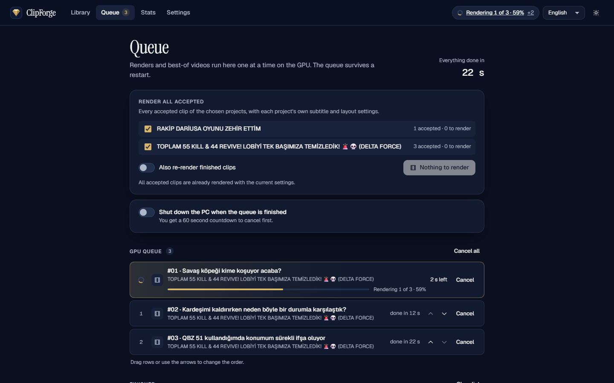
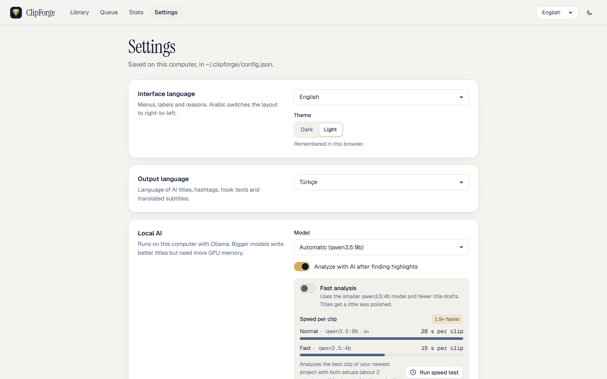
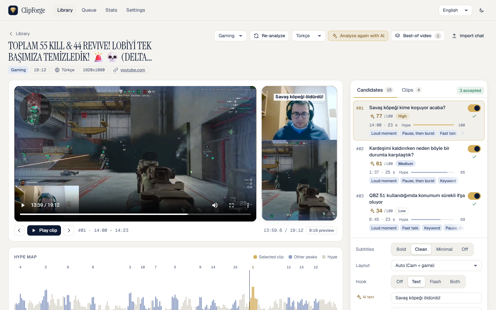

<p align="center">
  
</p>

<h1 align="center">ClipForge</h1>

<p align="center"><b>Free, local, AI-powered Shorts clipper for streamers.</b><br>
Point it at a stream VOD or a video file. It finds the best moments, writes the titles and renders
ready-to-post 9:16 clips, all on your own computer.</p>

<p align="center">
  <a href="https://github.com/utkualsir/clipforge/actions/workflows/ci.yml"></a>
  <a href="https://github.com/utkualsir/clipforge/releases/latest"></a>
  <a href="LICENSE"></a>
  
  
  
</p>

<p align="center">
  <a href="#install">Install</a> ·
  <a href="#features">Features</a> ·
  <a href="#faq">FAQ</a> ·
  <a href="#troubleshooting">Troubleshooting</a> ·
  <a href="docs/how-it-works.md">How it works</a> ·
  <a href="#türkçe">Türkçe</a>
</p>

<picture>
  <source media="(prefers-color-scheme: light)" srcset="docs/screenshots/project-light.png">
  
</picture>

## See it in action

Review a candidate, accept it, render. The clips land in the Clips tab, ready to download.


## Features

- **Finds the moments worth posting.** Volume spikes, laughter and shouting, reaction words
  ("NO WAY", "allah allah", "KEKW"), fast talk, chat explosions from the chat replay and, in study
  mode, self-contained explanations. All of it goes into one **Hype Map** with ranked clip candidates.
- **Cuts that make sense.** Clip edges snap to word boundaries (never mid-word), and the local AI
  can move them a few seconds to include the setup or the payoff.
- **A viral score and titles that sound like you.** A local language model rates every clip
  (hook, retention, trend fit), writes titles, hashtags, a hook text and a cover prompt. Thumbs
  up/down teach it your style; a glossary keeps names spelled right.
- **Ready-to-post 9:16 clips.** Facecam on top and gameplay below (detected automatically and
  adjustable), burned-in word-timed subtitles (also right-to-left Arabic), an optional hook text and
  a "peak flash" opener. Encodes on NVIDIA, Apple, Intel or AMD hardware when available.
- **Best-of videos.** One 16:9 YouTube video from your best clips, with title cards, crossfades,
  even loudness, and AI-written titles, description and chapters.
- **A render queue.** Reorder, cancel and retry jobs. The queue survives restarts and can shut the PC
  down when it's done.
- **Learns your channel.** Add the real YouTube views of published clips. After 10, ClipForge
  calibrates the score to what works on *your* channel.
- **Works with what you have.** Twitch, YouTube, Kick and most other sites (via yt-dlp), or any local
  video file. Streams of 3-6 hours are processed in resumable chunks.
- **A clean web UI in 7 languages**, dark and light, usable from your phone on the same Wi-Fi.
- **One-click install, one-click update.** A desktop shortcut opens it, and Settings → Updates
  installs new versions.

<table>
  <tr>
    <td width="50%"><br><sub><b>Library</b>: every stream with live progress</sub></td>
    <td width="50%"><br><sub><b>Clips</b>: rendered 9:16 clips, playable and downloadable</sub></td>
  </tr>
  <tr>
    <td><br><sub><b>Best-of video</b>: 16:9 compilation with chapters</sub></td>
    <td><br><sub><b>Queue</b>: batch renders that survive restarts</sub></td>
  </tr>
  <tr>
    <td><br><sub><b>Settings</b>: language, theme, local AI model</sub></td>
    <td><br><sub><b>Light theme</b>: every screen comes in dark and light</sub></td>
  </tr>
</table>

More screenshots, in both themes, are in [docs/screenshots](docs/screenshots).

## Privacy

**Everything runs on your computer. Nothing is uploaded.** There is no account, no cloud service,
no paid API and no telemetry. Transcription (Whisper), the language model (Qwen 3.5 via Ollama),
highlight detection and rendering all run locally. Your videos, transcripts and clips stay in
the `workspace` folder. ClipForge only goes online to download what you ask it to (a VOD, its
chat replay), the AI models (once), and updates (when you click "Check for updates").

## Supported hardware

ClipForge checks your hardware every time it starts and picks the fastest setup that works.

| Your computer | Speech-to-text | Local AI (titles, scores) |
|---|---|---|
| NVIDIA GPU, 6 GB+ VRAM (any series, incl. RTX 50) | Whisper large-v3-turbo on the GPU | qwen3.5:9b with 8 GB+ VRAM, else qwen3.5:4b |
| NVIDIA GPU, 2-6 GB VRAM | Whisper large-v3-turbo / medium (int8) | qwen3.5:4b |
| Apple Silicon Mac (M1-M4) | mlx-whisper on the GPU | qwen3.5:9b with 16 GB+ RAM, else 4b |
| AMD / Intel GPU, Intel Mac, no GPU | Whisper on the CPU (slower) | qwen3.5:4b |

- **Minimum:** Windows 10/11 (64-bit) or macOS 13+, 8 GB RAM, ~12 GB free disk space.
  **Recommended:** an NVIDIA RTX GPU with 8 GB VRAM, or an Apple Silicon Mac with 16 GB RAM.
- No CUDA Toolkit needed: the CUDA libraries come with the Python packages. If a model doesn't fit,
  ClipForge steps down by itself (float16 → int8 → smaller model → CPU).
- Measured on an RTX 5070 Laptop (8 GB): AI analysis ~28 s per clip (15 s with *Fast analysis*),
  rendering a 30 s 9:16 clip ~6 s with NVENC.

## Languages

| | Interface | Speech recognition | AI titles & subtitles |
|---|:-:|:-:|:-:|
| Türkçe (default) | ✓ | ✓ | ✓ |
| English | ✓ | ✓ | ✓ |
| Русский | ✓ | ✓ | ✓ |
| Magyar | ✓ | ✓ | ✓ |
| Deutsch | ✓ | ✓ | ✓ |
| العربية (right-to-left) | ✓ | ✓ | ✓ |
| 中文 | ✓ | ✓ | ✓ |

Titles can be written in another language than the one spoken; subtitles are then translated
with their timing kept.

## Install

### Windows 10 / 11: one click

1. Download **`ClipForge-Setup.bat`** from the [latest release](https://github.com/utkualsir/clipforge/releases/latest).
2. Double-click it. If Windows warns that the file is from the internet, choose **Run**. If
   SmartScreen says "Windows protected your PC", click **More info → Run anyway**.
3. The installer lists what it will set up (Python, FFmpeg, Git, Deno, Ollama, the Python packages
   and the AI models, ~12 GB at most). Things you already have are reused. Press **Enter** to start.
4. When it's done, double-click **ClipForge** on your desktop (or in the Start menu). It opens in
   your browser. ClipForge keeps running while its small minimized window is open; close that
   window to stop it.

Already cloned the repository? Double-click `install.bat` in the folder instead. Messages are in
Turkish or English, following your Windows language.

### macOS: one command

1. Download **`install.sh`** from the [latest release](https://github.com/utkualsir/clipforge/releases/latest).
2. Open **Terminal** and run:
   ```bash
   bash ~/Downloads/install.sh
   ```
   It installs Homebrew if needed (asks for your Mac password), then Python, FFmpeg, Git, Deno,
   Ollama, the Python packages and the AI models, after showing you the list.
3. Open **ClipForge** from Applications, or `ClipForge.command` on your Desktop.

### Manual install (developers)

You need Python 3.11-3.13, FFmpeg, Git, and for YouTube downloads Deno or Node.js.

```bash
git clone https://github.com/utkualsir/clipforge.git ClipForge
cd ClipForge
python -m venv .venv
.venv\Scripts\activate            # macOS: source .venv/bin/activate
python -m pip install -r backend/requirements.txt
python -m pip install -r backend/requirements-nvidia.txt   # NVIDIA GPU only
cd backend
python cli.py doctor --download-models    # checks everything, installs Ollama + models
python cli.py serve                       # opens http://localhost:8000
```

### Update

**Settings → Updates → Check for updates.** If a new version exists, click **Update now**: ClipForge
downloads it, installs any new packages and restarts by itself. Your projects and settings are
kept. (Running the installer again does the same.)

### Uninstall

- **Windows:** Settings → Apps → **ClipForge** → Uninstall, or run `installer\windows\uninstall.bat`.
- **macOS:** `bash ~/ClipForge/installer/macos/uninstall.sh` (use your ClipForge folder).

The uninstaller removes the app, its Python packages and the shortcuts. It **asks before deleting
your projects**, your settings and the downloaded AI models, and keeps them unless you say yes.
Python, FFmpeg, Git and Ollama stay installed, because other programs may use them.

## Usage

1. **New project**: paste a Twitch / YouTube / Kick link or a file path, or drop a video file. Pick
   the mode: *Gaming*, *Study* (lectures, podcasts) or *Music*.
2. ClipForge downloads it, transcribes it, finds the highlights and runs the AI analysis by itself.
   The Library shows live progress, and you can close the browser meanwhile.
3. **Review**: click a candidate to jump to it in the player and see the 9:16 preview. The Hype Map
   shows where the action is. Keyboard: ↑/↓ (or j/k) to move, `a` to accept.
4. **Accept** the clips you like, choose subtitles, layout and hook, then **Render**.
5. Download the MP4s from the **Clips** tab, copy a title and hashtags from the publish package, and
   post.

Optional: **Best-of video** turns your accepted clips into one YouTube video. **Add YouTube views**
on published clips lets ClipForge learn your channel. Settings has the UI language, the output
language for titles and subtitles, the AI model, your own trigger words and a glossary.

To use ClipForge from your phone, start it with `python cli.py serve --lan` (from the `backend`
folder) and open the address it prints. A command line for every step and the full technical
details are in **[docs/how-it-works.md](docs/how-it-works.md)**.

## FAQ

**Is it really free?**
Yes. ClipForge is MIT-licensed and uses only free, open-source tools and models. There are no
subscriptions, credits or watermarks.

**Do I need a gaming PC?**
No, but it helps. Without an NVIDIA GPU or Apple Silicon, transcription runs on the CPU: it works,
just more slowly. The AI titles use the smaller model on weaker machines.

**How long does a stream take?**
It depends on your hardware and the stream length. Transcription is the longest step on the CPU.
On an RTX 5070 Laptop the AI analysis takes ~28 s per clip. Long streams are processed in chunks
and resume where they stopped if you close ClipForge.

**Which sites can I import from?**
Twitch VODs, YouTube (videos and past live streams), Kick and most sites yt-dlp supports, plus any
local video file. The chat replay is fetched automatically for Twitch and YouTube; for others you
can import a chat log.

**Does it post to TikTok / YouTube for me?**
No. ClipForge never uploads anything. You download the clips and post them yourself.

**Where are my files?**
In the `workspace` folder inside the ClipForge folder (each project in its own subfolder, rendered
clips in `clips/`). Settings and your title preferences are in `~/.clipforge`.

**Can I use it without the AI part?**
Yes. Without Ollama, highlight detection, review and rendering still work; you just don't get
the viral score and titles.

**The installer is a .bat/.sh file. Is that safe?**
They are plain-text scripts. You can open them in a text editor and read every step before running
them. Nothing is installed before you confirm the list.

## Troubleshooting

| Problem | Fix |
|---|---|
| Something is missing or broken | Run the installer again (it repairs), or `python cli.py doctor` in the `backend` folder |
| "winget was not found" (Windows) | Install or update **App Installer** from the Microsoft Store, then run the installer again |
| Windows blocks the setup file | Right-click → Properties → tick **Unblock**, or SmartScreen → More info → Run anyway |
| The shortcut opens nothing | Open `installer\windows\ClipForge.bat` directly to see the error; port 8000-8099 must be free |
| `ffmpeg was not found` | Windows: `winget install --id Gyan.FFmpeg -e`, macOS: `brew install ffmpeg`, then restart ClipForge |
| YouTube download fails | Update yt-dlp: `python -m pip install -U "yt-dlp[default]"` and make sure Deno or Node.js is installed |
| GPU test fails | Update the NVIDIA driver, then run `python cli.py doctor` again (it falls back to the CPU meanwhile) |
| Transcription is slow | You're in CPU mode (see `doctor`); on weak PCs choose the *small* model in the config |
| AI analysis is slow or out of memory | Settings → Local AI → **Fast analysis**, or close games/OBS that use the GPU |
| No titles or viral score | Ollama isn't running: start Ollama, or run `python cli.py doctor` |
| Titles misspell a name | Add it to the **glossary** in Settings, then "Analyze again with AI" |
| "Couldn't reach GitHub" when updating | Check your internet connection; updates need Git (the installer adds it) |
| The update says files were changed | You edited files inside the ClipForge folder; run `git stash` there, or reinstall |

## Roadmap

- One-click installer for Linux
- Signed Windows installer (.exe) and macOS app (.dmg)
- Faster transcription on AMD and Intel GPUs
- More languages for the interface and title examples
- Smarter facecam tracking when the camera moves
- Batch import of a whole channel's VODs

Ideas and votes are welcome in [Issues](https://github.com/utkualsir/clipforge/issues).

## Contributing

Bug reports, translations and pull requests are welcome.

- **Bugs:** open an [issue](https://github.com/utkualsir/clipforge/issues/new/choose) with the output of
  `python cli.py doctor`. Please don't attach private videos.
- **Code:** see [Development](docs/how-it-works.md#development) for the setup. Before a pull request run
  `python -m ruff check backend installer`, `python -m pytest` and, for UI changes,
  `npm run build` plus `node scripts/check-i18n.mjs` in `frontend/`. CI runs the same checks.
- **Translations:** the UI texts are in `frontend/src/i18n/locales/`, and the title examples per
  language in `backend/clipforge/titles/examples/`.
- **New highlight signals:** subclass `Signal` in `backend/clipforge/highlights/signals/` and give it a
  weight in `modes.py`. Nothing else has to change.

## License

[MIT](LICENSE). ClipForge builds on [faster-whisper](https://github.com/SYSTRAN/faster-whisper),
[mlx-whisper](https://github.com/ml-explore/mlx-examples), [Ollama](https://ollama.com),
[Qwen](https://github.com/QwenLM), [yt-dlp](https://github.com/yt-dlp/yt-dlp),
[FFmpeg](https://ffmpeg.org), [sherpa-onnx](https://github.com/k2-fsa/sherpa-onnx),
[FastAPI](https://fastapi.tiangolo.com) and [React](https://react.dev). Thank you!

---

## Türkçe

**ClipForge, yayıncılar için ücretsiz, yerel ve yapay zekâ destekli bir Shorts kesicidir.** Bir yayın
kaydını (Twitch, YouTube, Kick) veya video dosyasını verirsiniz. ClipForge en iyi anları bulur,
başlıkları yazar ve paylaşmaya hazır 9:16 klipler oluşturur. Hepsi kendi bilgisayarınızda olur.

### Neler yapar?

- Ses patlamalarını, kahkaha ve bağırmaları, "allah allah", "NO WAY" gibi tepkileri, sohbetin
  coştuğu anları bulur ve hepsini **Hype Haritası**'nda sıralı klip adayları olarak gösterir.
- Kesimler kelimenin ortasına denk gelmez. Yapay zekâ gerekirse girişi veya sonucu da klibe katar.
- Her klibe **viral puan** verir; **başlık**, hashtag, kanca metni ve kapak fikri yazar. Beğendiğiniz
  başlıklardan sizin tarzınızı öğrenir.
- Facecam üstte, oyun altta olacak şekilde **9:16 klip** üretir; kelime kelime altyazı ve kanca
  metni ekler.
- En iyi kliplerden bölümlü, 16:9 bir **"en iyi anlar" videosu** hazırlar.
- Arayüzü 7 dildedir (varsayılan Türkçe), koyu ve açık tema vardır, telefondan da kullanılabilir.

### Gizlilik

**Her şey bilgisayarınızda çalışır; hiçbir şey internete yüklenmez.** Hesap, bulut, ücretli servis
veya veri toplama yoktur. İnternet yalnızca sizin istediğiniz videoyu, yapay zekâ modellerini (bir
kez) ve güncellemeleri indirmek için kullanılır.

### Kurulum (Windows 10 / 11)

1. [Son sürüm](https://github.com/utkualsir/clipforge/releases/latest) sayfasından
   **`ClipForge-Setup.bat`** dosyasını indirin.
2. Çift tıklayın. Windows uyarı verirse **Çalıştır**'ı, SmartScreen çıkarsa **Ek bilgi → Yine de
   çalıştır**'ı seçin.
3. Kurulum aracı neleri kuracağını listeler (Python, FFmpeg, Git, Deno, Ollama, Python paketleri,
   yapay zekâ modelleri; en fazla ~12 GB). Bilgisayarınızda olanları yeniden kurmaz. Başlamak için
   **Enter**'a basın.
4. Bitince masaüstündeki **ClipForge** simgesine çift tıklayın; tarayıcıda açılır. Küçültülmüş
   pencere açık kaldığı sürece çalışır, kapatmak için o pencereyi kapatın.

Kurulum mesajları Windows diliniz Türkçe ise Türkçe gösterilir.

**macOS:** `install.sh` dosyasını indirip Terminal'de `bash ~/Downloads/install.sh` komutunu
çalıştırın. Ardından Uygulamalar'daki **ClipForge**'u açın.

### Kullanım

1. **Yeni proje**: bağlantıyı yapıştırın veya videoyu sürükleyip bırakın, modu seçin (Oyun / Ders /
   Müzik).
2. ClipForge videoyu indirir, yazıya döker, öne çıkan anları bulur ve yapay zekâ analizini kendisi
   yapar.
3. Adaylara tıklayıp önizleyin, beğendiklerinizi **Kabul edin**, ardından **Klipleri oluştur**'a basın.
4. **Klipler** sekmesinden MP4'leri indirin; başlık ve hashtag'leri kopyalayıp paylaşın.

### Güncelleme ve kaldırma

- **Güncelleme:** Ayarlar → Güncellemeler → **Güncellemeleri denetle** → **Şimdi güncelle**.
  ClipForge yeni sürümü indirir ve kendini yeniden başlatır; projeleriniz ve ayarlarınız korunur.
- **Kaldırma:** Ayarlar → Uygulamalar → **ClipForge** → Kaldır (veya `installer\windows\uninstall.bat`).
  Projelerinizi silmeden önce **mutlaka sorar**.

### Sık sorulanlar

- **Ücretsiz mi?** Evet, tamamen ücretsiz ve açık kaynaklıdır (MIT). Filigran veya kredi yoktur.
- **Güçlü bir bilgisayar gerekir mi?** Şart değil. NVIDIA ekran kartı veya Apple Silicon ile çok daha
  hızlıdır; ekran kartı olmadan da çalışır, sadece daha yavaştır.
- **Klipleri benim yerime paylaşır mı?** Hayır. ClipForge hiçbir şey yüklemez; klipleri siz indirip
  paylaşırsınız.
- **Bir sorun mu var?** Kurulum aracını tekrar çalıştırın (eksikleri onarır) veya
  [bir hata kaydı açın](https://github.com/utkualsir/clipforge/issues/new/choose).
