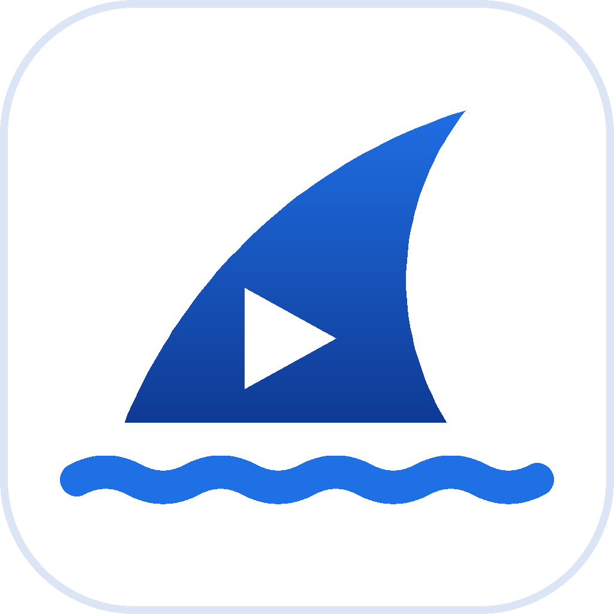
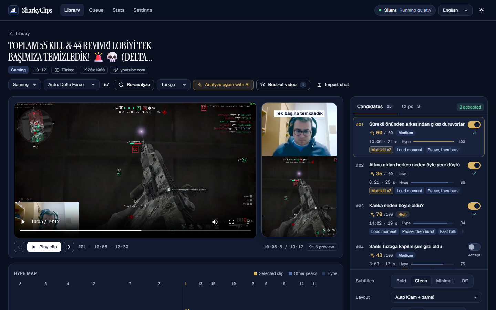
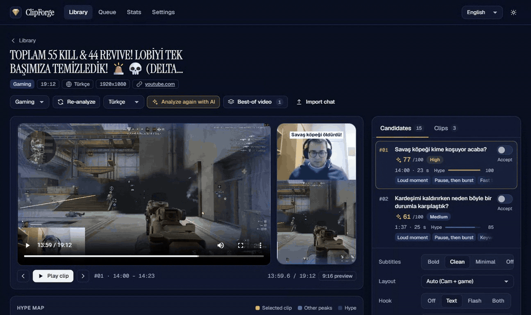
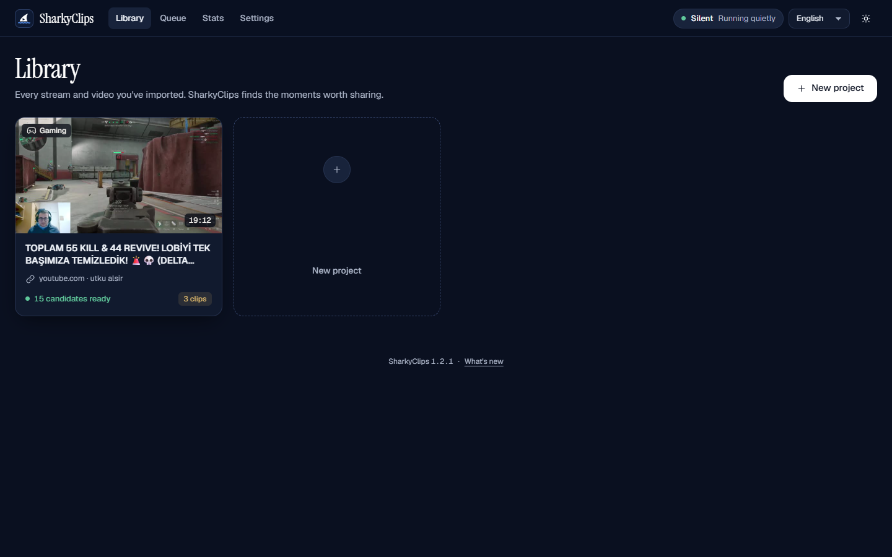
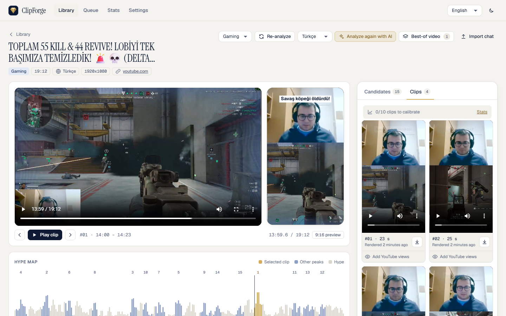
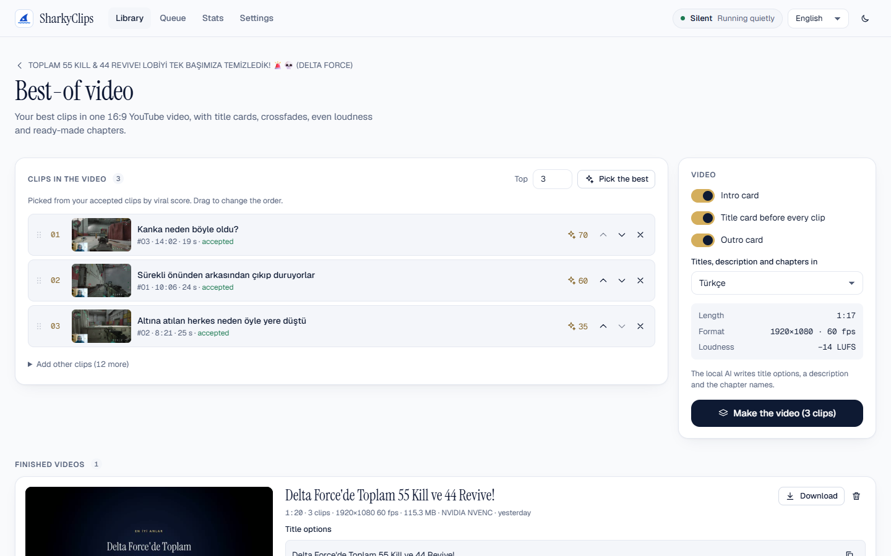
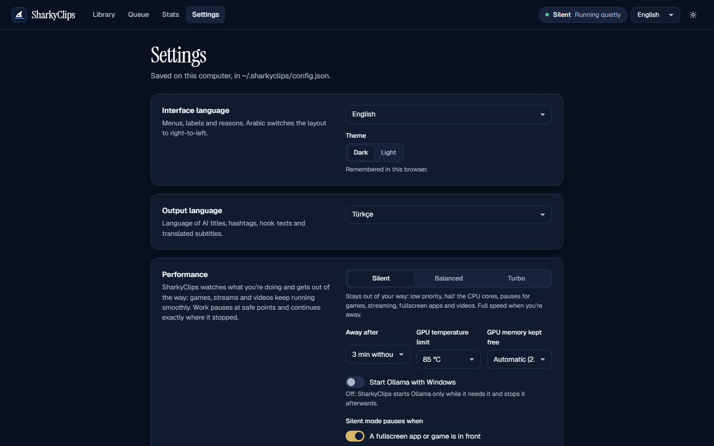
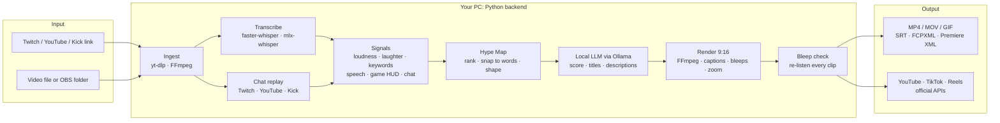

<p align="center">
  <picture>
    <source media="(prefers-color-scheme: dark)" srcset="assets/icon/sharkyclips.png">
    
  </picture>
</p>

<h1 align="center">SharkyClips</h1>

<p align="center"><b>Your stream in, ready-to-post Shorts out. Free, and 100% on your own PC.</b></p>

<p align="center">
SharkyClips watches your Twitch, YouTube or Kick VOD (or any video file) the way an editor would:
it hears the hype, reads the chat replay and the game's HUD, cuts the best moments, bleeps the
swears, writes the titles and posts 9:16 clips to YouTube Shorts, TikTok and Instagram Reels.
No account, no cloud, no credits, no watermark.<br>
<sub>Formerly ClipForge: old links redirect, and your settings move over by themselves.</sub>
</p>

<p align="center">
  <a href="https://github.com/utkualsir/sharkyclips/actions/workflows/ci.yml"></a>
  <a href="https://github.com/utkualsir/sharkyclips/releases/latest"></a>
  <a href="LICENSE"></a>
  
  
  
</p>

<p align="center">
  <a href="#install"><b>Install</b></a> ·
  <a href="#highlights">Highlights</a> ·
  <a href="#how-it-works">How it works</a> ·
  <a href="#all-features">All features</a> ·
  <a href="#faq">FAQ</a> ·
  <a href="docs/how-it-works.md">Technical guide</a> ·
  <a href="#türkçe">Türkçe</a>
</p>

<picture>
  <source media="(prefers-color-scheme: light)" srcset="docs/screenshots/project-light.png">
  
</picture>

## Highlights

<table>
  <tr>
    <td width="33%" valign="top"><b>🔒 Free &amp; local</b><br>Whisper, the language model, highlight detection and rendering run on your GPU or CPU. MIT-licensed, no subscription, no telemetry. Nothing leaves your PC unless you press Publish.</td>
    <td width="33%" valign="top"><b>🎮 Game-aware clips</b><br>Loudness, laughter, reaction words, chat explosions and, for Delta Force and League of Legends, the HUD itself: kills, multikills, objectives. A pentakill is never cut in half.</td>
    <td width="33%" valign="top"><b>🤐 Swears bleeped, checked</b><br>Swears in 7 languages are bleeped or muted, and every rendered clip is listened to again. A clip with an audible swear is held back instead of posted.</td>
  </tr>
  <tr>
    <td valign="top"><b>📤 One Publish, three platforms</b><br>YouTube Shorts, TikTok and Instagram Reels from one button: per-platform captions and limits, planned times, retries, views coming back. TikTok's required post screen is built in.</td>
    <td valign="top"><b>🌍 7 languages</b><br>Interface, speech recognition, titles and subtitles in English, Türkçe, Deutsch, Magyar, Русский, العربية (right-to-left) and 中文. Titles can be in another language than the one spoken.</td>
    <td valign="top"><b>🦈 Stays out of your way</b><br>Silent mode pauses while you play or watch fullscreen and gives the game its VRAM back. Easy mode does everything by itself; Pro mode gives you every knob.</td>
  </tr>
</table>

## See it in action

Review a candidate, accept it, render. The clips land in the Clips tab, ready to download.



<table>
  <tr>
    <td width="50%"><br><sub><b>Library</b>: every stream with live progress</sub></td>
    <td width="50%"><br><sub><b>Clips</b>: rendered 9:16 clips, playable and downloadable</sub></td>
  </tr>
  <tr>
    <td><br><sub><b>Best-of video</b>: 16:9 compilation with chapters</sub></td>
    <td><br><sub><b>Settings</b>: language, performance mode, accounts, local AI</sub></td>
  </tr>
</table>

More screenshots, in both themes, are in [docs/screenshots](docs/screenshots).

## How it works



The web UI (React) talks to a local FastAPI server on `127.0.0.1`. A persistent job queue runs
the heavy steps in lanes (GPU, CPU, I/O, network), and a resource governor decides how fast they
may run from what you're doing (game in front, fullscreen video, away from the PC). Whisper and
the language model never share the GPU. Every step caches its result, so a closed app resumes where
it stopped. Details: **[docs/how-it-works.md](docs/how-it-works.md)**.

## Tech stack

| Layer | Built with |
|---|---|
| UI | React 18, TypeScript, Vite; 7 locales with a completeness check in CI; dark and light themes; axe-checked accessibility |
| Server | Python 3.11-3.13, FastAPI + Uvicorn, a persistent multi-lane job queue, a resource governor (psutil, NVML) |
| Speech | faster-whisper (CUDA / CPU), mlx-whisper (Apple Silicon), a CTC aligner for word timing, sherpa-onnx (laughter, voices) |
| Analysis | NumPy / SciPy signal scoring, librosa (music mode), OpenCV (facecam), RapidOCR (game HUD) |
| Language model | Ollama with Qwen 3.5 (4B / 9B, picked from your VRAM), structured JSON output |
| Video | FFmpeg filter graphs, NVENC / VideoToolbox / QSV / AMF hardware encoding, yt-dlp |
| Publishing | YouTube Data + Analytics APIs (OAuth + PKCE), TikTok Content Posting API, Instagram Graph API; tokens encrypted with DPAPI / Keychain |
| Quality | 600+ pytest tests on Windows, Ubuntu and macOS; ruff; a Playwright layout check at 9 screen sizes (phone to 1920 px) in 3 languages and both themes; a pixel check that the live preview matches the render |
| Install | One-click PowerShell (Windows) and shell (macOS) installers, in-app updates via git |


## All features

<details>
<summary><b>Everything SharkyClips does</b> (click to open)</summary>

- **Easy mode (the default).** Drop a video or paste a link: SharkyClips picks the best clips,
  shapes them (smart cuts, length and pacing for Shorts, a hook check with a banner), renders them
  and shows them as a grid with one Publish button each. Autopilot can even post them on a schedule
  and send you a morning summary. Pro mode keeps every setting below.
- **Swear check after every render.** Each rendered clip is listened to again; a swear that is still
  audible is bleeped wider and re-rendered, and if it still can't be fixed the clip is held back from
  automatic uploads until you listen to it.
- **One Publish for YouTube, TikTok and Instagram Reels.** Per-platform captions with the limits
  checked (and one-tap fixes), planned times, retries with backoff, crash-safe resumable posts, and
  views flowing back from every platform. TikTok's required post screen (privacy, interactions,
  content disclosure) is built in.
- **Finds the moments worth posting.** Volume spikes, laughter and shouting, reaction words
  ("NO WAY", "allah allah", "KEKW"), fast talk, chat explosions from the chat replay and, in study
  mode, self-contained explanations. All of it goes into one **Hype Map** with ranked clip candidates.
- **Knows the game.** For **Delta Force** and **League of Legends** it reads the game's HUD: kills,
  multikills (pentakill >> double kill), first blood, objectives, own deaths, victory/defeat and
  extraction screens, in English and Turkish clients. Clips always contain the whole multikill, and
  the AI writes titles from these events ("Quadra kill with Teemo"). The game is recognized from the title or what's said, or
  picked per project; a **Game detection** page shows what was read, so the HUD boxes can be fixed
  after a game update. Optional: your own short sound clips (announcer lines) are found in the audio.
- **Cuts that make sense.** Clip edges snap to word boundaries (never mid-word), and the local AI
  can move them a few seconds to include the setup or the payoff.
- **A viral score and titles that sound like you.** A local language model rates every clip
  (hook, retention, trend fit), writes titles, a **YouTube description** (2-3 sentences + hashtags),
  hashtags, a hook text and a cover prompt, each with a copy button. Thumbs up/down teach it your
  style; a glossary keeps names spelled right.
- **Ready-to-post 9:16 clips.** Facecam on top and gameplay below (detected automatically and
  adjustable), burned-in word-timed subtitles (also right-to-left Arabic), an optional hook text and
  a "peak flash" opener. Encodes on NVIDIA, Apple, Intel or AMD hardware when available.
- **Editing tools.** Swear words bleeped or muted (7 languages, editable lists, "a**" in the
  captions; on by default for Shorts-style videos), silences and filler words ("um", "ııı", "äh"...)
  cut with tiny crossfades but never inside a laugh, a subtle smart zoom on the peak moments and on
  your facecam when you react, and **edit by transcript**: delete words to cut them, drag the first
  and last word to trim, with undo and a live preview.
- **Your own music and brand.** Drop your songs (e.g. your AI songs) into the music library and tag
  their mood; SharkyClips suggests a fitting one per clip, starts it at its strongest part, ducks it
  under your voice and keeps the mix at -14 LUFS, with an optional credit line for YouTube. A brand
  kit adds your logo watermark, @handle, intro/outro cards and caption style with one switch.
- **Fast review.** Keyboard shortcuts for everything (A keep, X skip, J/K/L, I/O to mark your own
  clip...) and a full-screen, swipe-style review of one clip at a time.
- **Export for every platform.** MP4 (H.264, HEVC, AV1 on recent GPUs), MOV, WebM, GIF with a size
  limit, MP3/M4A. One-click presets for **YouTube Shorts, TikTok, Instagram Reels, X and YouTube 16:9**
  set size, fps, bitrate and length limit and keep subtitles out of each app's buttons. The file size
  is estimated before anything renders; several clips export in one go.
- **Subtitle files and editor timelines.** SRT/VTT in all 7 languages (translated locally when
  needed), FCPXML for DaVinci Resolve / Final Cut Pro and XML for Premiere Pro with the cut, captions
  and markers for the detected moments.
- **Direct YouTube upload** (optional) through the free official API: one click on **Connect with
  Google** (or your own Google project under Advanced):
  title, description and hashtags from the publish package, privacy, scheduling, thumbnail, a daily
  quota counter, and views that flow back into the calibration by themselves.
- **Clips by themselves after a stream.** Switch it on and SharkyClips watches the folder OBS records
  into: when a recording is finished, the best clips are found, rendered and titled, only while your
  PC isn't busy. Mark moments while you play with **Ctrl+Alt+C** (works in games, no focus change) or
  **!clip** in your Twitch / YouTube chat (you and your mods): they become the first clips.
- **Approve from your phone.** Your own free Telegram bot sends each ready clip with Upload / Plan /
  Skip buttons, or swipe through them on the approval page on your Wi-Fi (PIN protected).
- **Instant replay, chat bubbles, meme effects.** The big moment again in smooth slow motion with a
  REPLAY badge, real (filtered) chat messages as bubbles, and optional meme freezes with a caption the
  local AI writes in your language. Sound effects are made on your PC.
- **Best-of videos.** One 16:9 YouTube video from your best clips, with title cards, crossfades,
  even loudness, and AI-written titles, description and chapters.
- **A render queue.** Reorder, cancel and retry jobs. The queue survives restarts and can shut the PC
  down when it's done.
- **Learns your channel.** Add the real YouTube views of published clips. After 10, SharkyClips
  calibrates the score to what works on *your* channel.
- **Works with what you have.** Twitch, YouTube and Kick VODs and clips (with their chat replay), most
  other sites (via yt-dlp), or any local video file. Streams of 3-6 hours are processed in resumable chunks.
- **A clean web UI in 7 languages**, dark and light, usable from your phone on the same Wi-Fi.
- **One-click install, one-click update.** A desktop shortcut opens it, and Settings → Updates
  installs new versions. A short setup on the first start (language, content types, performance
  mode + a hardware check), and a "What's new" note after every update.

</details>

## Privacy

**Everything runs on your computer. Nothing leaves it unless you press Upload.** There is no
account, no cloud service, no paid API and no telemetry. Transcription (Whisper), the language model (Qwen 3.5 via Ollama),
highlight detection and rendering all run locally. Your videos, transcripts and clips stay in
the `workspace` folder. SharkyClips only goes online to download what you ask it to (a VOD, its
chat replay), the AI models (once), and updates (when you click "Check for updates"). The optional
YouTube upload talks only to Google's official API; your sign-in is stored encrypted on your
computer and never goes anywhere else. Optional too: your own Telegram bot (phone approval; it gets
the clip's cover and title, and the video when you tap Watch) and reading your Twitch / YouTube live
chat (only for "!clip" and the chat bubbles; it never posts). Details: [privacy policy](https://utkualsir.github.io/sharkyclips-site/privacy.html) ·
[terms](https://utkualsir.github.io/sharkyclips-site/terms.html).

## Supported hardware

SharkyClips checks your hardware every time it starts and picks the fastest setup that works.

| Your computer | Speech-to-text | Local AI (titles, scores) |
|---|---|---|
| NVIDIA GPU, 6 GB+ VRAM (any series, incl. RTX 50) | Whisper large-v3-turbo on the GPU | qwen3.5:9b with 8 GB+ VRAM, else qwen3.5:4b |
| NVIDIA GPU, 2-6 GB VRAM | Whisper large-v3-turbo / medium (int8) | qwen3.5:4b |
| Apple Silicon Mac (M1-M4) | mlx-whisper on the GPU | qwen3.5:9b with 16 GB+ RAM, else 4b |
| AMD / Intel GPU, Intel Mac, no GPU | Whisper on the CPU (slower) | qwen3.5:4b |

- **Minimum:** Windows 10/11 (64-bit) or macOS 13+, 8 GB RAM, ~12 GB free disk space.
  **Recommended:** an NVIDIA RTX GPU with 8 GB VRAM, or an Apple Silicon Mac with 16 GB RAM.
- No CUDA Toolkit needed: the CUDA libraries come with the Python packages. If a model doesn't fit,
  SharkyClips steps down by itself (float16 → int8 → smaller model → CPU).
- Measured on a mid-range laptop GPU (RTX 5070 Laptop, 8 GB): AI analysis ~28 s per clip (15 s with *Fast analysis*),
  rendering a 30 s 9:16 clip ~6 s with NVENC.

## Languages

| | Interface | Speech recognition | AI titles & subtitles |
|---|:-:|:-:|:-:|
| Türkçe (default) | ✓ | ✓ | ✓ |
| English | ✓ | ✓ | ✓ |
| Русский | ✓ | ✓ | ✓ |
| Magyar | ✓ | ✓ | ✓ |
| Deutsch | ✓ | ✓ | ✓ |
| العربية (right-to-left) | ✓ | ✓ | ✓ |
| 中文 | ✓ | ✓ | ✓ |

Titles can be written in another language than the one spoken; subtitles are then translated
with their timing kept.

## Install

### Windows 10 / 11: one click

1. Download **`SharkyClips-Setup.bat`** from the [latest release](https://github.com/utkualsir/sharkyclips/releases/latest).
2. Double-click it. If Windows warns that the file is from the internet, choose **Run**. If
   SmartScreen says "Windows protected your PC", click **More info → Run anyway**.
3. The installer lists what it will set up (Python, FFmpeg, Git, Deno, Ollama, the Python packages
   and the AI models, ~12 GB at most). Things you already have are reused. Press **Enter** to start.
4. When it's done, double-click **SharkyClips** on your desktop (or in the Start menu). It opens in
   your browser. No console window stays open: the SharkyClips icon next to the clock opens it again,
   switches the performance mode or quits it.

Already cloned the repository? Double-click `install.bat` in the folder instead. Messages are in
Turkish or English, following your Windows language.

### macOS: one command

1. Download **`install.sh`** from the [latest release](https://github.com/utkualsir/sharkyclips/releases/latest).
2. Open **Terminal** and run:
   ```bash
   bash ~/Downloads/install.sh
   ```
   It installs Homebrew if needed (asks for your Mac password), then Python, FFmpeg, Git, Deno,
   Ollama, the Python packages and the AI models, after showing you the list.
3. Open **SharkyClips** from Applications, or `SharkyClips.command` on your Desktop.

### Manual install (developers)

You need Python 3.11-3.13, FFmpeg, Git, and for YouTube downloads Deno or Node.js.

```bash
git clone https://github.com/utkualsir/sharkyclips.git SharkyClips
cd SharkyClips
python -m venv .venv
.venv\Scripts\activate            # macOS: source .venv/bin/activate
python -m pip install -r backend/requirements.txt
python -m pip install -r backend/requirements-nvidia.txt   # NVIDIA GPU only
cd backend
python cli.py doctor --download-models    # checks everything, installs Ollama + models
python cli.py serve                       # opens http://localhost:8000
```

### Update

**Settings → Updates → Check for updates.** If a new version exists, click **Update now**: SharkyClips
downloads it, installs any new packages and restarts by itself. Your projects and settings are
kept. (Running the installer again does the same.)

### Uninstall

- **Windows:** Settings → Apps → **SharkyClips** → Uninstall, or run `installer\windows\uninstall.bat`.
- **macOS:** `bash ~/SharkyClips/installer/macos/uninstall.sh` (use your SharkyClips folder).

The uninstaller removes the app, its Python packages and the shortcuts. It **asks before deleting
your projects**, your settings and the downloaded AI models, and keeps them unless you say yes.
Python, FFmpeg, Git and Ollama stay installed, because other programs may use them.

## Usage

1. **New project**: paste a Twitch / YouTube / Kick link or a file path, or drop a video file. Pick
   the mode: *Gaming*, *Study* (lectures, podcasts) or *Music*.
2. SharkyClips downloads it, transcribes it, finds the highlights and runs the AI analysis by itself.
   The Library shows live progress, and you can close the browser meanwhile.
3. **Review**: click a candidate to jump to it in the player and see the 9:16 preview. The Hype Map
   shows where the action is. Keyboard: ↑/↓ (or j/k) to move, `a` to accept.
4. **Accept** the clips you like, choose subtitles, layout and hook, then **Render**.
5. Download the MP4s from the **Clips** tab, copy a title and the description from the publish package, and
   post.

Optional: **Best-of video** turns your accepted clips into one YouTube video. **Add YouTube views**
on published clips lets SharkyClips learn your channel. Settings has the UI language, the output
language for titles and subtitles, the AI model, your own trigger words and a glossary.

**SharkyClips stays out of your way.** In the default **Silent** mode it works at idle priority on
half of your CPU cores, keeps ~2 GB of GPU memory free and **pauses** while a game, OBS, a
fullscreen app or a video is on (the AI model is unloaded so the game gets the VRAM back). When you
haven't touched the PC for 3 minutes, or the screen is locked, it runs at full speed and steps back
the moment you return. **Balanced** never pauses but stays throttled; **Turbo** is full speed for
when you're away. Switch modes in the top bar or the tray icon; the top bar also shows CPU, GPU,
VRAM and temperature (click it for 5-minute charts, SharkyClips vs. other apps). Paused work continues
exactly where it stopped. Ollama no longer starts with Windows unless you turn it on in Settings.

To use SharkyClips from your phone, start it with `python cli.py serve --lan` (from the `backend`
folder) and open the address it prints. Set an **access PIN** first (Settings → Other devices, or
`python cli.py lan-pin`): without one, anyone on your network can use it. A command line for every step and the full technical
details are in **[docs/how-it-works.md](docs/how-it-works.md)**.

## FAQ

**Is it really free?**
Yes. SharkyClips is MIT-licensed and uses only free, open-source tools and models. There are no
subscriptions, credits or watermarks.

**Do I need a gaming PC?**
No, but it helps. Without an NVIDIA GPU or Apple Silicon, transcription runs on the CPU: it works,
just more slowly. The AI titles use the smaller model on weaker machines.

**How long does a stream take?**
It depends on your hardware and the stream length. Transcription is the longest step on the CPU.
On a mid-range laptop GPU (8 GB) the AI analysis takes ~28 s per clip. Long streams are processed in chunks
and resume where they stopped if you close SharkyClips.

**Which sites can I import from?**
Twitch VODs, YouTube (videos and past live streams), Kick and most sites yt-dlp supports, plus any
local video file. The chat replay is fetched automatically for Twitch, Kick and YouTube; for others you
can import a chat log.

**Does it post to YouTube, Instagram and TikTok for me?**
Only if you want it to. Connect your accounts once (Settings → Accounts: YouTube with one click,
Instagram and TikTok through your own free developer app, with a step-by-step guide) and press
Publish on a clip: it goes to every platform you switched on, now or at a planned time. Nothing
is ever posted on its own unless you turn on Autopilot. For X you download the clip and post it
yourself.

**Where are my files?**
In the `workspace` folder inside the SharkyClips folder (each project in its own subfolder, rendered
clips in `clips/`). Settings and your title preferences are in `~/.sharkyclips`.

**Can I use it without the AI part?**
Yes. Without Ollama, highlight detection, review and rendering still work; you just don't get
the viral score and titles.

**The installer is a .bat/.sh file. Is that safe?**
They are plain-text scripts. You can open them in a text editor and read every step before running
them. Nothing is installed before you confirm the list.

## Troubleshooting

| Problem | Fix |
|---|---|
| Something is missing or broken | Run the installer again (it repairs), or `python cli.py doctor` in the `backend` folder |
| "winget was not found" (Windows) | Install or update **App Installer** from the Microsoft Store, then run the installer again |
| Windows blocks the setup file | Right-click → Properties → tick **Unblock**, or SmartScreen → More info → Run anyway |
| The shortcut opens nothing | Look at `%USERPROFILE%\.sharkyclips\logs\sharkyclips.log`, or run `python cli.py launch` in the `backend` folder to see the error; port 8000-8099 must be free |
| A game or video stutters while SharkyClips works | Use **Silent** mode (top bar); add the game's process name in Settings → Performance if it isn't detected |
| `ffmpeg was not found` | Windows: `winget install --id Gyan.FFmpeg -e`, macOS: `brew install ffmpeg`, then restart SharkyClips |
| YouTube download fails | Update yt-dlp: `python -m pip install -U "yt-dlp[default]"` and make sure Deno or Node.js is installed |
| GPU test fails | Update the NVIDIA driver, then run `python cli.py doctor` again (it falls back to the CPU meanwhile) |
| Transcription is slow | You're in CPU mode (see `doctor`); on weak PCs choose the *small* model in the config |
| AI analysis is slow or out of memory | Settings → Local AI → **Fast analysis**, or close games/OBS that use the GPU |
| No titles or viral score | Ollama isn't running: start Ollama, or run `python cli.py doctor` |
| Titles misspell a name | Add it to the **glossary** in Settings, then "Analyze again with AI" |
| "Couldn't reach GitHub" when updating | Check your internet connection; updates need Git (the installer adds it) |
| The update says files were changed | You edited files inside the SharkyClips folder; run `git stash` there, or reinstall |

## Roadmap

- [x] Publish queue for Claude in Chrome: <10 MB files, calendar, status import (1.2.40)
- [x] Delete clips and projects with a 30-day trash, undo, disk usage and clean-up (1.2.41)
- [x] Automatic TikTok through TikTok Studio, one Publish for YouTube + Instagram + TikTok, publish-queue check (1.2.42)
- [x] Instagram + TikTok step-by-step posting without an account (1.2.39)
- [x] Kick VOD + clip import with chat replay (1.2.38)
- [x] One Publish for YouTube, TikTok and Instagram Reels (1.2.36)
- [x] Easy mode with Autopilot (1.2.34)
- [ ] Google verification + YouTube API audit (answers ready in [docs/audits](docs/audits/README.md))
- [ ] TikTok app review, so TikTok posts can be public right away
- [ ] One-click installer for Linux
- [ ] Signed Windows installer (.exe) and macOS app (.dmg)
- [ ] Faster transcription on AMD and Intel GPUs
- [ ] Smarter facecam tracking when the camera moves
- [ ] Batch import of a whole channel's VODs

Ideas and votes are welcome in [Issues](https://github.com/utkualsir/sharkyclips/issues).

## Contributing

Bug reports, translations and pull requests are welcome. The full guide is in
**[CONTRIBUTING.md](CONTRIBUTING.md)**; security issues go to [SECURITY.md](SECURITY.md).

- **Bugs:** open an [issue](https://github.com/utkualsir/sharkyclips/issues/new/choose) with the output of
  `python cli.py doctor`. Please don't attach private videos.
- **Code:** see [Development](docs/how-it-works.md#development) for the setup. Before a pull request run
  `python -m ruff check backend installer`, `python -m pytest` and, for UI changes,
  `npm run build` plus `node scripts/check-i18n.mjs` in `frontend/`. CI runs the same checks.
- **Translations:** the UI texts are in `frontend/src/i18n/locales/`, and the title examples per
  language in `backend/sharkyclips/titles/examples/`.
- **New highlight signals:** subclass `Signal` in `backend/sharkyclips/highlights/signals/` and give it a
  weight in `modes.py`. Nothing else has to change.

## License

[MIT](LICENSE). SharkyClips builds on [faster-whisper](https://github.com/SYSTRAN/faster-whisper),
[mlx-whisper](https://github.com/ml-explore/mlx-examples), [Ollama](https://ollama.com),
[Qwen](https://github.com/QwenLM), [yt-dlp](https://github.com/yt-dlp/yt-dlp),
[FFmpeg](https://ffmpeg.org), [sherpa-onnx](https://github.com/k2-fsa/sherpa-onnx),
[RapidOCR](https://github.com/RapidAI/RapidOCR) / [PaddleOCR](https://github.com/PaddlePaddle/PaddleOCR) models,
[FastAPI](https://fastapi.tiangolo.com) and [React](https://react.dev). Thank you!

---

## Türkçe

*En iyi anların avlanmaya hazır.*

**SharkyClips, yayıncılar için ücretsiz, yerel ve yapay zekâ destekli bir Shorts kesicidir.** Bir yayın
kaydını (Twitch, YouTube, Kick) veya video dosyasını verirsiniz. SharkyClips en iyi anları bulur,
başlıkları ve YouTube açıklamasını yazar, paylaşmaya hazır 9:16 klipler oluşturur. Hepsi kendi
bilgisayarınızda olur.

Eski adı ClipForge'du: eski bağlantılar yeni adrese yönlenir, ayarlarınız kendiliğinden taşınır.

### Neler yapar?

- Ses patlamalarını, kahkaha ve bağırmaları, "allah allah", "NO WAY" gibi tepkileri, sohbetin
  coştuğu anları bulur ve hepsini **Hype Haritası**'nda sıralı klip adayları olarak gösterir.
- **Delta Force** ve **League of Legends** için oyunun arayüzünü okur: kill, çoklu kill (pentakill,
  quadra...), ilk kan, hedefler, ölümler, zafer/bozgun ve tahliye ekranları (Türkçe ve İngilizce
  istemci). Çoklu kill'in tamamı klibe girer; yapay zekâ başlıkları bu olaylarla yazar.
- Kesimler kelimenin ortasına denk gelmez. Yapay zekâ gerekirse girişi veya sonucu da klibe katar.
- Her klibe **viral puan** verir; **başlık**, **YouTube açıklaması** (2-3 cümle + etiketler),
  hashtag, kanca metni ve kapak fikri yazar; hepsi tek tıkla kopyalanır. Beğendiğiniz başlıklardan
  sizin tarzınızı öğrenir.
- Facecam üstte, oyun altta olacak şekilde **9:16 klip** üretir; kelime kelime altyazı ve kanca
  metni ekler.
- **Düzenleme araçları:** küfürleri bip'ler veya susturur (7 dil, düzenlenebilir liste, altyazıda
  "a**"), sessizlikleri ve "ııı", "eee", "şey" gibi dolgu kelimelerini küçük geçişlerle keser (gülme
  anının içinde asla), önemli anlarda ve tepki verdiğinizde facecam'de hafif yakınlaştırma yapar.
  **Metinden düzenleme:** kelimeyi silince videodan kesilir, ilk ve son kelimeyi sürükleyince klip
  kırpılır; geri alma ve canlı önizleme vardır.
- **Kendi müziğiniz ve markanız:** şarkılarınızı (örneğin yapay zekâ şarkılarınızı) müzik kitaplığına
  bırakıp havasını etiketleyin; her klibe uygun olanı önerir, en güçlü kısmından başlatır, konuşurken
  kısar, sesi -14 LUFS'ta tutar. Marka kiti logo filigranı, @kullanıcı adı, giriş/kapanış kartları ve
  altyazı stilini tek düğmeyle ekler.
- Her şey için **klavye kısayolları** (A tut, X geç, J/K/L, kendi klibiniz için I/O) ve adayları tek
  tek, tam ekran, kaydırarak inceleyebileceğiniz **hızlı inceleme** modu.
- **Yayın bitince klipler kendiliğinden:** açarsanız OBS'nin kayıt klasörünü izler; kayıt bitince en
  iyi klipleri bulur, hazırlar ve başlıklarını yazar (sadece bilgisayar meşgul değilken). Oynarken
  **Ctrl+Alt+C** (oyunda çalışır, odağı çalmaz) ya da Twitch / YouTube sohbetinde **!clip** (siz ve
  moderatörleriniz) ile anı işaretleyin: ilk klipler o anlar olur.
- **Telefondan onay:** ücretsiz kendi Telegram botunuz her hazır klibi Yükle / Planla / Atla
  düğmeleriyle gönderir; ya da Wi-Fi'daki onay sayfasında (PIN korumalı) kaydırarak karar verin.
- **Anlık tekrar, sohbet balonları, meme efektleri:** büyük an akıcı ağır çekimde REPLAY etiketiyle bir
  daha, o andaki gerçek (süzülmüş) sohbet mesajları balon olarak ve isteğe bağlı, yerel yapay zekânın
  sizin dilinizde yazdığı yazıyla meme donmaları. Ses efektleri bilgisayarınızda üretilir.
- En iyi kliplerden bölümlü, 16:9 bir **"en iyi anlar" videosu** hazırlar.
- Her platform için **dışa aktarır**: MP4 (H.264, HEVC, AV1), MOV, WebM, GIF, MP3/M4A; YouTube Shorts,
  TikTok, Instagram Reels, X ve YouTube 16:9 için tek tıkla ayarlar, SRT/VTT altyazı dosyaları ve
  DaVinci Resolve / Final Cut Pro / Premiere Pro için kurgu zaman çizelgeleri.
- İsterseniz klipleri resmî YouTube API'siyle, tek tıkla (**Google ile bağlan**) **doğrudan YouTube'a yükler**
  (başlık, açıklama, etiketler, görünürlük, zamanlama, küçük resim).
- Arayüzü 7 dildedir (varsayılan Türkçe), koyu ve açık tema vardır, telefondan da kullanılabilir.
  İlk açılışta kısa bir kurulum (dil, içerik türü, performans modu + donanım kontrolü) ve her
  güncellemeden sonra "Yenilikler" penceresi gelir.

### Gizlilik

**Her şey bilgisayarınızda çalışır; siz Yükle'ye basmadıkça hiçbir şey dışarı çıkmaz.** Hesap, bulut, ücretli servis
veya veri toplama yoktur. İnternet yalnızca sizin istediğiniz videoyu, yapay zekâ modellerini (bir
kez) ve güncellemeleri indirmek için kullanılır. İsteğe bağlı YouTube yüklemesi yalnızca Google'ın
resmî API'siyle, sizin oluşturduğunuz ve bilgisayarınızdan çıkmayan bir anahtarla konuşur. Yine isteğe bağlı:
kendi Telegram botunuz (telefondan onay; klibin kapağını ve başlığını, İzle'ye basarsanız videoyu alır) ve
Twitch / YouTube canlı sohbetinizi okumak (sadece "!clip" ve sohbet balonları için; asla yazmaz).

### Kurulum (Windows 10 / 11)

1. [Son sürüm](https://github.com/utkualsir/sharkyclips/releases/latest) sayfasından
   **`SharkyClips-Setup.bat`** dosyasını indirin.
2. Çift tıklayın. Windows uyarı verirse **Çalıştır**'ı, SmartScreen çıkarsa **Ek bilgi → Yine de
   çalıştır**'ı seçin.
3. Kurulum aracı neleri kuracağını listeler (Python, FFmpeg, Git, Deno, Ollama, Python paketleri,
   yapay zekâ modelleri; en fazla ~12 GB). Bilgisayarınızda olanları yeniden kurmaz. Başlamak için
   **Enter**'a basın.
4. Bitince masaüstündeki **SharkyClips** simgesine çift tıklayın; tarayıcıda açılır. Açık kalan bir
   pencere olmaz: saatin yanındaki SharkyClips simgesinden tekrar açabilir, performans modunu
   değiştirebilir veya kapatabilirsiniz.

Kurulum mesajları Windows diliniz Türkçe ise Türkçe gösterilir.

**macOS:** `install.sh` dosyasını indirip Terminal'de `bash ~/Downloads/install.sh` komutunu
çalıştırın. Ardından Uygulamalar'daki **SharkyClips**'u açın.

### Kullanım

1. **Yeni proje**: bağlantıyı yapıştırın veya videoyu sürükleyip bırakın, modu seçin (Oyun / Ders /
   Müzik).
2. SharkyClips videoyu indirir, yazıya döker, öne çıkan anları bulur ve yapay zekâ analizini kendisi
   yapar.
3. Adaylara tıklayıp önizleyin, beğendiklerinizi **Kabul edin**, ardından **Klipleri oluştur**'a basın.
4. **Klipler** sekmesinden MP4'leri indirin; başlığı ve açıklamayı kopyalayıp paylaşın.

**Bilgisayarınızı yavaşlatmaz.** Varsayılan **Sessiz** modda düşük öncelikle, işlemci çekirdeklerinin
yarısıyla çalışır, ekran kartında ~2 GB boş bırakır; oyun, OBS, tam ekran uygulama veya video
açıkken **duraklar** (yapay zekâ modeli bellekten atılır). Bilgisayara 3 dakika dokunmadığınızda ya da
ekran kilitliyken tam hızla çalışır, döndüğünüz anda geri çekilir. **Dengeli** hiç durmaz ama
yavaş çalışır; **Turbo** başında değilken tam hızdır. Modu üst çubuktan veya saat yanındaki simgeden
değiştirin. Ollama, Ayarlar'dan açmadığınız sürece Windows ile başlamaz.

### Güncelleme ve kaldırma

- **Güncelleme:** Ayarlar → Güncellemeler → **Güncellemeleri denetle** → **Şimdi güncelle**.
  SharkyClips yeni sürümü indirir ve kendini yeniden başlatır; projeleriniz ve ayarlarınız korunur.
- **Kaldırma:** Ayarlar → Uygulamalar → **SharkyClips** → Kaldır (veya `installer\windows\uninstall.bat`).
  Projelerinizi silmeden önce **mutlaka sorar**.

### Sık sorulanlar

- **Ücretsiz mi?** Evet, tamamen ücretsiz ve açık kaynaklıdır (MIT). Filigran veya kredi yoktur.
- **Güçlü bir bilgisayar gerekir mi?** Şart değil. NVIDIA ekran kartı veya Apple Silicon ile çok daha
  hızlıdır; ekran kartı olmadan da çalışır, sadece daha yavaştır.
- **Klipleri benim yerime paylaşır mı?** Yalnızca siz isterseniz. Hesaplarınızı bir kez bağlayın
  (Ayarlar → Hesaplar: YouTube tek tıkla, Instagram ve TikTok adım adım rehberle kendi ücretsiz
  geliştirici uygulamanızla) ve klipte Yayınla'ya basın: açtığınız her platforma şimdi ya da
  planladığınız saatte gider. Otomatik pilotu açmadıkça kendiliğinden hiçbir şey paylaşmaz. X için
  klibi indirip kendiniz paylaşırsınız.
- **Bir sorun mu var?** Kurulum aracını tekrar çalıştırın (eksikleri onarır) veya
  [bir hata kaydı açın](https://github.com/utkualsir/sharkyclips/issues/new/choose).
