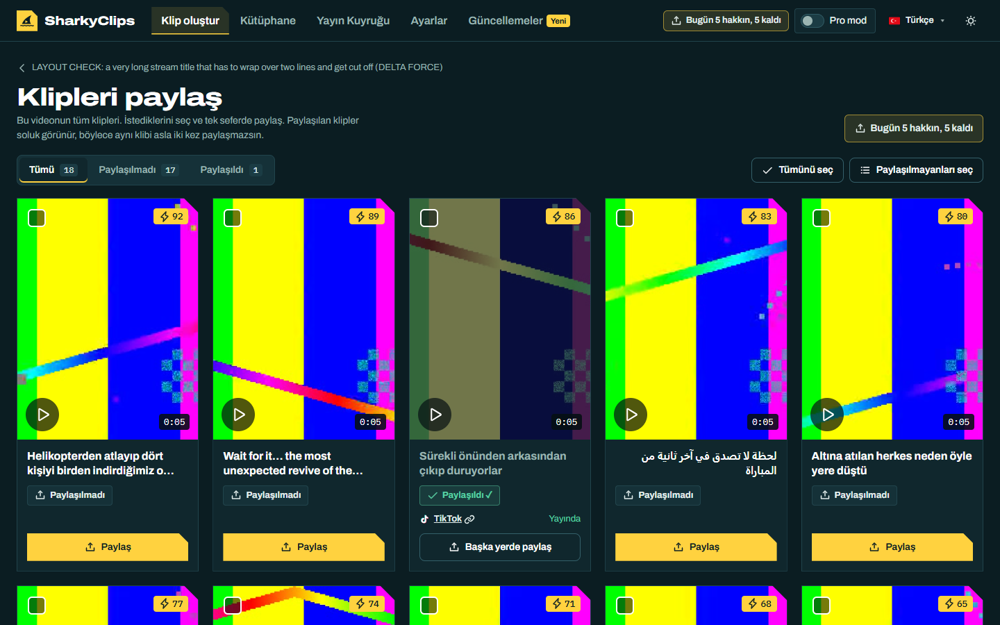
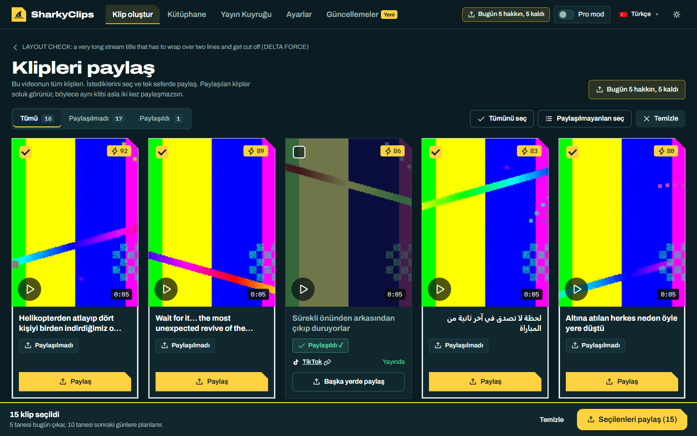
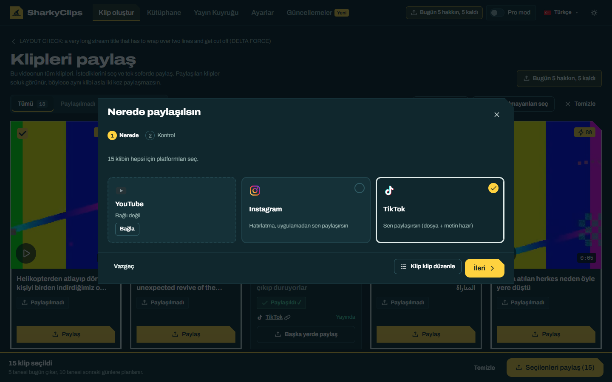
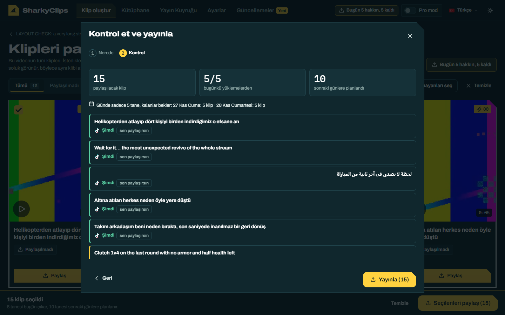
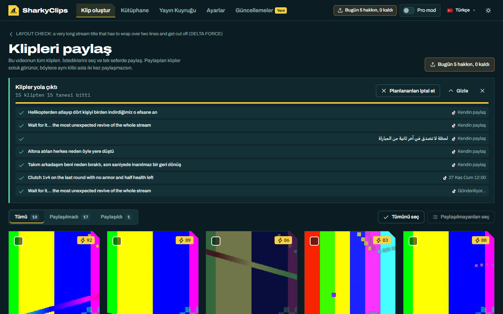

# Toplu paylaşım (1.2.66) — "Klipleri paylaş"

## Kısa rapor (Türkçe)

**Ne yapıldı:** Her projede yeni bir **"Klipleri paylaş"** ekranı var (Kolay ve Pro modda proje
başlığındaki sarı butonla açılır, adres `#/p/<proje>/share`). Videonun **bütün klipleri** büyük bir
ızgarada: büyük resim, üstüne gelince / dokununca oynatma, süre, viral puanı, başlık. Her kartta net
bir durum rozeti var: **Paylaşılmadı / Planlandı (gün, saat) / Paylaşıldı ✓ (platform simgeleri +
gönderi bağlantısı) / Başarısız (tek dokunuşla Yeniden dene)**. Paylaşılan klipler soluk; Tümü /
Paylaşılmadı / Paylaşıldı sekmeleri var.

- **Seçim:** her kartta onay kutusu, "Tümünü seç", "Paylaşılmayanları seç", altta büyük
  "Seçilenleri paylaş (N)". Her kartın kendi "Paylaş" butonu da var. Klavye: Esc seçimi temizler,
  Ctrl+A görünenlerin hepsini seçer.
- **Günlük sınır:** varsayılan **günde 5**, Ayarlar'dan 1–6 (6 = YouTube ücretsiz kotası). Üst
  çubukta ve paylaşım ekranında her zaman "Bugün 5 hakkın, 3 kaldı". Kalandan fazlası seçilirse
  fazlası **kendiliğinden sonraki günlere** en iyi saatlere (45 dk arayla) planlanır; özet bunu gün
  gün gösterir.
- **Akış:** Paylaş → platformlar (sadece bağlı olanlar; diğerleri gri + "Bağla") → isteğe bağlı
  "Klip klip düzenle" (başlık / açıklama / etiketler / altyazı ve platformlar) → **özet** (ne, nereye,
  ne zaman, bugünkü haktan kaçı) → **Yayınla**. Son platform seçimi hatırlanır.
- **Instagram:** 4 saat arası korunur (özette "kaydırıldı" notuyla), Elle mod / kapalı kuralları
  aynen duruyor. TikTok'un günlük sınırı da artık genel sınırı takip ediyor.
- **İlerleme paneli:** toplu gönderimde her klibin her platformdaki durumu; "Planlananları iptal et".
- **Geri al:** plandan çıkarma / iptal 8 saniye bekler, "Geri al" ile vazgeçilebilir (sunucuya
  hiçbir şey gitmeden; YouTube'daki planlı video silinip yeniden yüklenmez).
- **Çift paylaşım uyarısı:** zaten paylaşılmış / planlanmış klip seçilirse uyarı çıkar, klip sadece
  henüz olmadığı platformlara gider (sunucu da asla ikinci kez göndermez).

**Kontroller:** backend testleri (yeni `test_share.py`: sınır, sonraki günlere kaydırma, çift
paylaşım, rozetler, toplu + tek klip, Instagram aralığı, plandan çıkarma, yeniden dene, olmayan
platform), 11 dil (i18n kontrolü OK), layout kontrolü (348 görünüm, yeni Share ekranları dahil),
axe erişilebilirlik (44 görünüm, Share panosu / seçim / platform adımı / özet dahil), önizleme
kontrolü — hepsi geçti. Sürüm 1.2.66, CHANGELOG 11 dilde.

### Ekran görüntüleri (sentetik test projesi)

| | |
|---|---|
|  |  |
|  |  |
|  | |

Yeniden çekmek için: `python frontend/scripts/layout-fixture.py <dir>`, sunucuyu aç, sonra
`SHOT_PUBLISH=1 node frontend/scripts/share-shots.mjs <url> layout-check-stream-0001 <out> tr dark`.

---

## Decisions log (unattended run)

1. **One daily limit, counted per clip per local day, over all platforms and projects.** A clip that
   goes to YouTube + TikTok on the same day uses one upload. Planned, being sent, waiting-for-you and
   live posts count; failed / cancelled ones don't. (`web/share.py: releases_by_clip, day_usage`)
2. **Default 5, max 6.** `publishing.DEFAULT_LIMIT = 5`, `DAILY_MAX = 6`, `platforms.DAILY_POST_MAX = 6`
   (this replaces the 1.2.50 cap of 3, as asked). YouTube capacity is now counted by the upload
   itself (1,600 units after the 300-unit reserve) = 6 a day on the free 10,000; a thumbnail /
   playlist step that no longer fits uses the existing deferral to the next day.
3. **TikTok's automatic cap follows the daily limit** unless the user set a lower TikTok number; a
   saved `3` from before 1.2.66 (the old forced maximum) counts as "follow".
4. **The server makes every plan.** `/plan` and `/publish` take only clips + platforms (+ per-clip
   platforms); times are recomputed on publish. Today's clips go "now"; the rest go to the next days
   at the best release times, 45 minutes apart.
5. **Never twice.** Platforms where a clip is already live / planned / being sent are skipped and
   reported as duplicates; the UI warns before, offers "Leave them out".
6. **Too long / too short for a platform** (fix "turn_off"): in a batch that platform is left out for
   that clip with the reason shown, instead of blocking the whole batch. Other problems (e.g. a title
   too long) still block Publish and point to "Edit per clip".
7. **Publishing runs in a background thread** through the same `multipost.start` as the single
   Publish button (one call per planned time group, YouTube first), progress in
   `<project>/share_batch.json`. A batch cut off by a restart shows as "stopped".
8. **Undo = delayed commit in the UI** (8 s). Nothing is sent before the undo window ends, so undo
   never has to re-upload a deleted YouTube video. Leaving the page sends pending unschedules.
   Cancelling a running upload is final (1.2.24 rule), so "Cancel planned" only covers planned and
   not-yet-sent posts.
9. **"Select not shared"** picks only clips with nothing planned / failed / live; the "Not shared" tab
   shows everything not live yet (so planned and failed ones are visible there too).
10. **YouTube hashtags can now be edited per clip** (drafts `youtube.hashtags`), used by the upload and
    the social captions.
11. **Card media is 3:4** (vertical feel, more cards per screen); the top-bar pill is hidden below
    860 px (the Share board shows the big one).
12. Fixture: `layout-fixture.py` now adds a shared, a scheduled and a failed post so every badge is
    checked by the layout / axe runs. This surfaced an existing label mismatch on the post-badge
    link (fixed).
