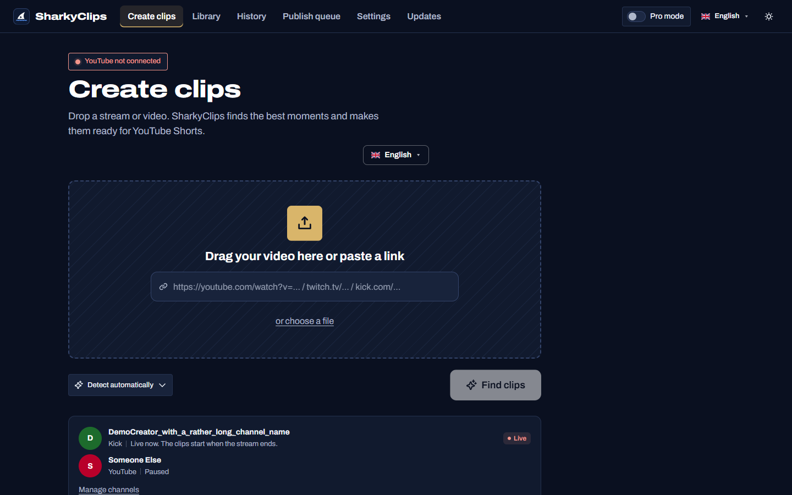
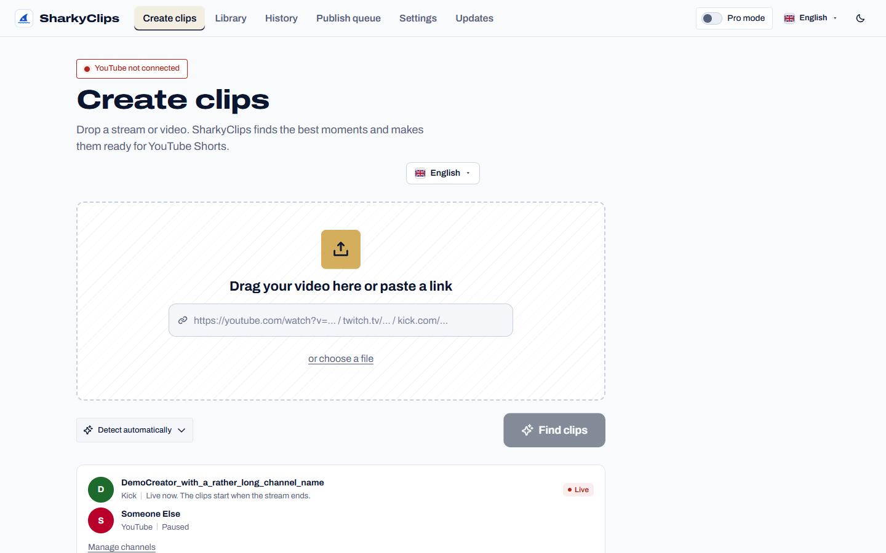
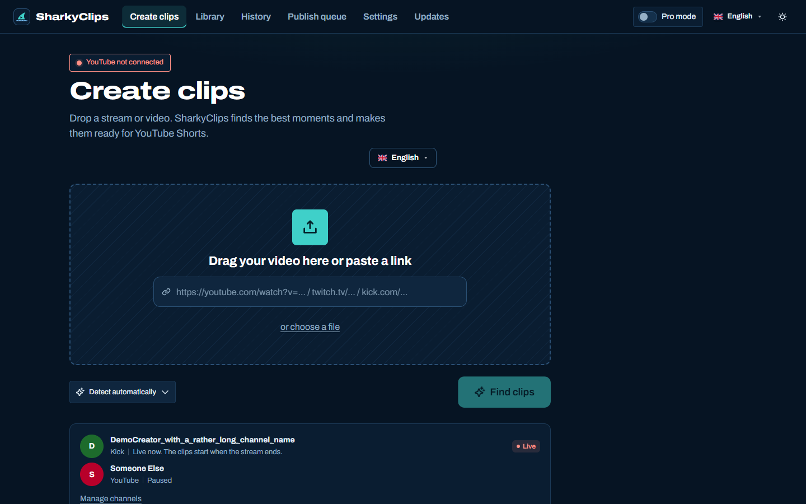
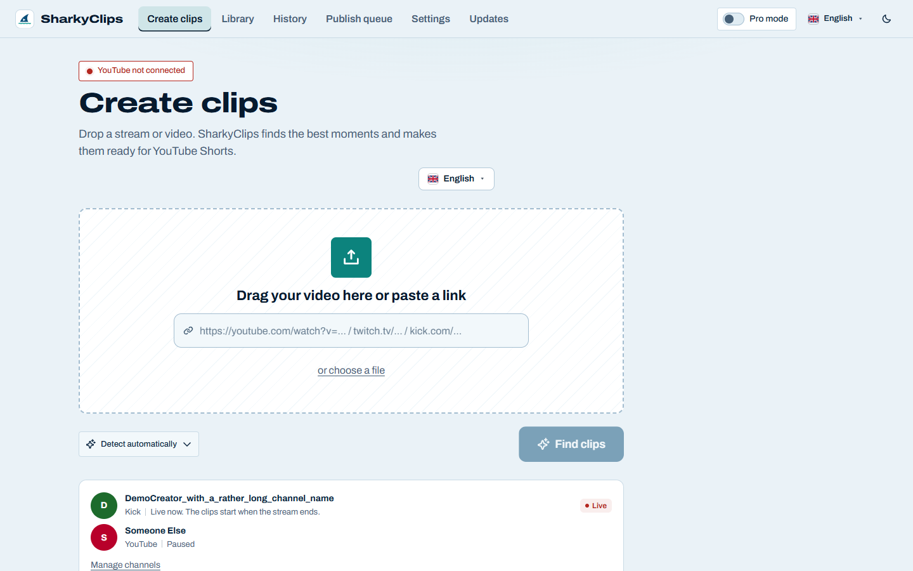
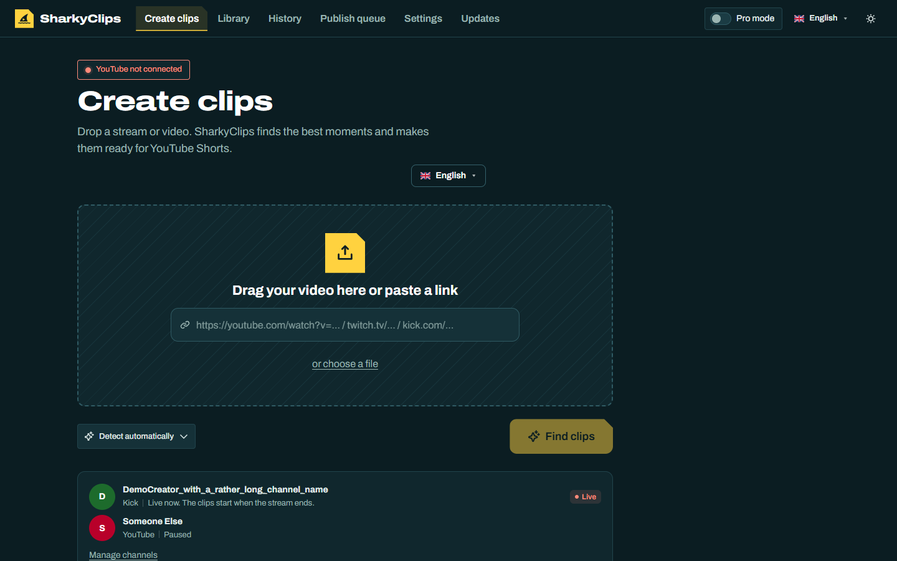
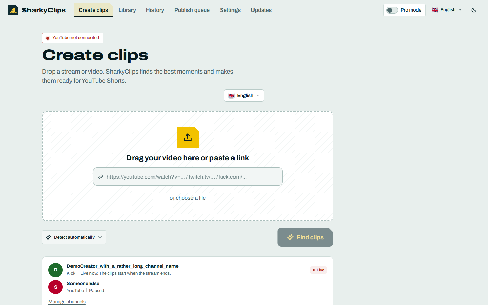
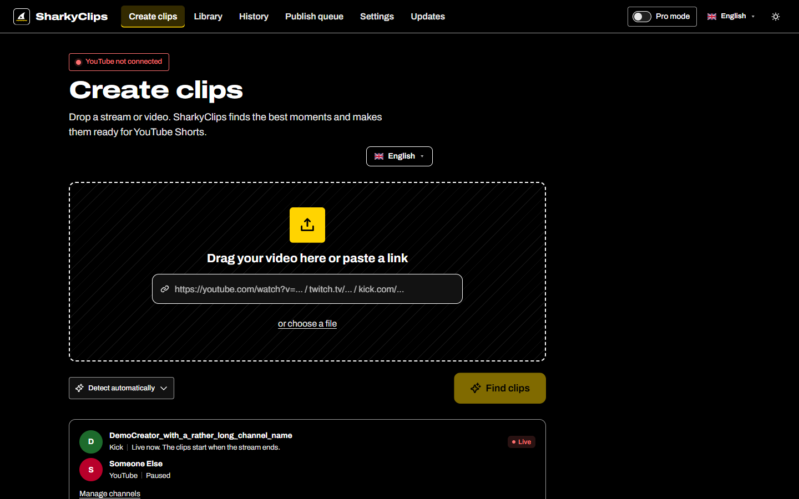
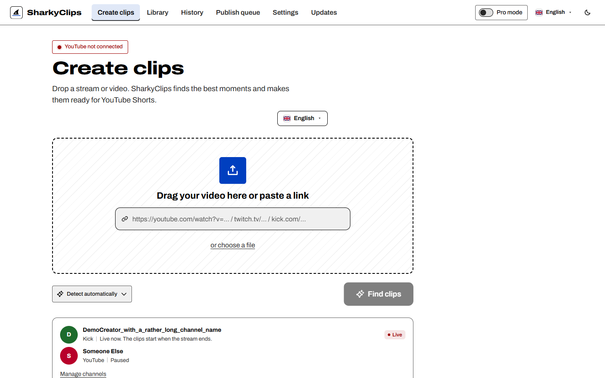

# Phase D2 (1.2.69, 2026-11-26): Personalization, Classic back as default

## Rapor (Türkçe)

**1.2.69 yayında.** 1.2.65 öncesinin lacivert + altın görünümü ("Klasik") yeniden varsayılan;
1.2.65'in yeni yazı düzeni (yerel Archivo + IBM Plex Mono, temiz yazı boyutu ölçeği, 4 köşe
yarıçapı, boşluk düzeni) aynen kaldı. Sarı "Shark Sign" artık sadece seçilebilen bir görünüm.

- **Ayarlar → Kişiselleştirme** (Kolay ve Pro modda aynı panel):
  - Mod: Açık / Koyu / Windows'u izle (bilgisayar değişince anında geçer).
  - Görünüm: **Klasik** (varsayılan), **Okyanus** (yeni: gece denizi mavisi + deniz camı turkuazı,
    yukarıdan hafif bir yüzey ışığı; açık modda güneşli sığ deniz), **Shark Sign**, **Yüksek
    karşıtlık** (siyah/beyaz + sarı ya da mavi vurgu).
  - Vurgu rengi: 12 renklik palet + istediğin renk. Butonlar, açık sekme, ilerleme çubukları,
    vurgular ve odak çerçevesi bu rengi alır; istersen pencere başlık çubuğu da.
  - Ayrıntılı renkler (açık ve koyu mod için ayrı): arka plan, paneller/kartlar, yazı, ikincil
    yazı, kenarlıklar, butonlar, bağlantılar, başarılı/uyarı/hata, bip ve altyazı vurgusu.
  - Otomatik karşıtlık kontrolü: her değişiklik WCAG AA'ya göre (yazı 4.5:1, işaretler 3:1)
    kontrol edilir; okunmaz hale gelen yazı aynı tonda koyulaştırılıp/açılarak düzeltilir ve
    panel bunu söyler (kapatılabilir).
  - Canlı önizleme (bütün uygulama anında değişir + panelde örnek kart), Varsayılana dön, tema
    dosyası dışa/içe aktarma (`sharkyclips-theme-*.json`, sadece #rrggbb renkler kabul edilir).
- **Sabit renk kalmadı:** bütün renkler `frontend/src/themes.css` içinde. Kolay, Pro, pencereler,
  mini oyun (su ve deniz tabanı temaya uyuyor), açılış animasyonu, açılış (splash) sayfası ve
  TikTok/Instagram giriş dönüş sayfaları temayı kullanıyor. Yeni test
  (`test_theme_tokens.py`) bütün CSS/TSX dosyalarını, index.html'i, splash'ı ve sunucunun
  yazdığı sayfaları tarıyor. İzin verilen tek istisnalar sanat eseri dosyaları: bayraklar,
  platform/Google logoları, videoya basılan dışa aktarma renkleri (önizleme = video) ve mini
  oyunun balık/köpekbalığı renkleri.
- **1.2.68 küçük işler:** "Bu videodan klipler <tarih> tarihinde paylaşıldı" uyarısı artık videoyu
  bırakır bırakmaz (Kolay ana sayfa ve Pro "Yeni proje" penceresi) çıkıyor; dosyanın parmak izi
  tarayıcıda hesaplanıyor (3 MiB okunuyor), yol yazılırsa sunucu hesaplıyor. **Instagram:**
  hesabın yeniden aktif; "askıya alındı" notları güncellendi, güvenli ayarlar (Elle mod, 4 saat
  arası, en fazla 5 etiket, aynı açıklama tekrar yok) aynen duruyor; Instagram yeniden varsayılan
  paylaşım hedeflerinde (Elle modda, otomatik paylaşım yok).
- **Kontroller:** pytest + ruff temiz, i18n 11 dil temiz (3280 anahtar). Yerelde: layout
  Okyanus / Shark Sign / Yüksek karşıtlık 1116 görünüm + Klasik hızlı tur 372 görünüm temiz; axe
  4 görünüm × açık/koyu 209 görünüm temiz; yeni Kişiselleştirme tarayıcı testi 19/19 (görünüm,
  vurgu, okunmaz yazının düzeltilmesi, yeniden yüklemede kalması, tema dosyası, sıfırlama).
  Klasik'in tam layout turu CI'da koşuyor.

### Görünümler

| | Koyu | Açık |
|---|---|---|
| Klasik (varsayılan) |  |  |
| Okyanus |  |  |
| Shark Sign |  |  |
| Yüksek karşıtlık |  |  |

Pro editör ve Kişiselleştirme paneli her görünümde: `phase-d2/pro-editor-*.png`,
`phase-d2/settings-*.png`.

---

## Decision log (unattended session)

### 0. Follow-ups from 1.2.68

- **Import-time warning.** The 1.2.68 check needed a project (the server fingerprints the project's
  source). Now the browser fingerprints the dropped / picked file itself (`frontend/src/fingerprint.ts`,
  the same SHA-256 of size + three 1 MiB samples as `history.fingerprint`, checked against Python by
  `test_import_history.py`) and asks `GET /api/history/source?fp=`. A path typed into the box is
  fingerprinted by the server (`POST /api/history/check-path`, this computer only, like `api_create`).
  URLs: no check (nothing to hash before the download). The notice moved to
  `components/SharedBefore.tsx` and is shared by the Share page, Easy home (stays visible while the
  import runs) and the Pro "New project" dialog.
- **crypto.subtle** is missing on plain-http LAN pages (phone): `fingerprint.ts` carries a small
  SHA-256 for that case.
- **Instagram active again.** No "suspended" state existed in the app data, only the 1.2.62 flag
  that took Instagram out of the default targets (`ig_paused_at`) and notes in docs. Notes updated
  (`phase-d1.md`, `tooling.md`, `igpace.py` docstring, memory). Kept as asked: Manual mode
  (`META_AUTOMATION` stays off), the 4 h pace warning, max 5 hashtags, no repeated caption, account
  errors never retried. Instagram was put back into the user's remembered publish targets through
  the running app's settings API (Manual mode only: SharkyClips prepares, the user posts).

### 1. Classic as the default, the new type kept

- Classic = the 1.2.64 navy + gold colour tokens, mapped onto the 1.2.65 token set (the new roles
  `--select`, `--on`, `--on-sign`, `--danger-fill`, `--media-bg`, `--tip-bg`, launch and mini game
  colours got Classic values from 1.2.64 where they existed). Kept from 1.2.65: Archivo + IBM Plex
  Mono, the 10-step type scale, 4 radii, no shadows / blur / pills / caps eyebrows, `Sep`, one
  page-enter motion, Phosphor icons.
- The fin-cut corner is Shark Sign's identity, so it is now a preset token: `--cut-k` (0 / 1)
  scales every cut (also the per-element 9 / 12 px ones), and the shapes that were square for the
  cut get `--fin-r` / `--fin-r-card` (Classic / Ocean: 8 / 12 px, High contrast: 6 px, Sign: 0).
- Everyone moves to Classic on update (the request: "the previous theme as the default"). The
  previous dark / light choice (`cf-theme`) is kept as the mode.
- App icon, installer art and the public site keep the 1.2.65 logo (not part of the request;
  the in-app logo tile follows the preset through `--mark-*`).

### 2. Personalization

- **Where colours live:** `frontend/src/themes.css`, one block per preset x mode on
  `<html data-preset data-theme>`. A light block repeats every colour of its dark block
  (`test_light_block_repeats_the_dark_colours`), otherwise the dark value would leak into light
  mode through the cascade.
- **Own colours / accent** are inline custom properties on `<html>` (they win over the blocks).
  `personalize.ts` computes them for both modes at once (switching `<html>` for a moment inside one
  task: nothing paints) and stores them in localStorage `sc-personal`; the pre-paint script in
  `index.html` applies the right mode before the app loads (no flash), also the title bar colour
  (`<meta name="theme-color">`).
- **Derived colours:** panels -> panel 2 / 3 and chips (4.5 % / 9 % towards the text colour);
  borders -> strong border (30 %); accent -> soft / line / focus / chart colour / text on accent
  (black or white, whichever reads better); button -> hover shade and text colour.
- **The contrast check** covers text on background / panels, secondary text, chips, buttons, text on
  the accent, accent text, links, success / warning / error, bleep text, the launch screen (4.5:1)
  and bleep / caption / switch marks (3:1). The fix moves the colour along the line to black or
  white (whichever side reads better on that background) with a binary search, so the hue stays.
- **Picking a look resets the accent and own colours** (Windows does the same); Reset = Classic,
  Follow Windows, no accent, no own colours.
- **Server copy:** config `ui_personal` (checked by `personal.clean`: known keys, `#rrggbb` only),
  newest wins between browser and server (`at`). The splash page gets the theme's launch colours
  (`ui_splash`, both modes, `welcome.clean_splash`: plain colours only, since it is written into a
  `<style>` block); the TikTok / Instagram sign-in result pages use the same colours
  (`welcome.result_page`).
- **Title bar:** `theme-color` is the background colour, or the accent when the toggle is on (only
  with an accent picked). It shows in the installed app window / Edge app mode.
- **Accent palette** is a token list (`--accent-1..12`) so the TSX holds no colour.
- **Ocean**, designed for this release: abyssal blue surfaces (`#061423` -> `#14304b`), sea-glass
  teal `#3fd0c9` for every action and "hit" (dark text on it), sky blue links / caption highlight,
  coral bleeps, and a faint radial "surface light" from the top of the page (`--page-glow`). Light
  mode = a sunny shallow: mist blue page, deep-sea blue buttons (`#0b4f7a`, white text), teal
  `#0c837d` marks.
- **High contrast:** black / white, borders strong, yellow `#ffd400` (dark) / blue `#003fbf`
  (light) as the accent, a double focus ring, small 6 px corners.
- Links: real links in running text (`.md`, notices, hints, paragraphs) use `--link`; the quiet
  `.link-btn` buttons stay muted as before.

### 3. No hard-coded colours

- 440 literals before; now only in `themes.css` and five artwork files the test names:
  `Flags.tsx` (moved out of `LanguageSwitcher.tsx`), `PlatformIcons.tsx` (+ Google's "G", moved out
  of `YoutubeConnect.tsx`), `exportLook.ts` (the 9:16 preview draws what the renderer burns in:
  preview = export, so these never follow the theme), `minigame/art.ts` (fish / shark sprites) and
  `themeMath.ts` (builds `rgba()` strings). The game's water, sea floor and HUD follow the theme
  (`--mg-*`).
- The first-run screen keeps "always light": `data-theme-local="light"` gives it the preset's light
  tokens inside a dark page (its old private `--w-*` palette is gone).
- Over-video colours (scrims, white text on video, phone mock-ups, platform colours, Google's
  button) are fixed tokens in `themes.css`.

### 4. Checks

- Layout: Classic as before (Turkish, Arabic, English x 9 sizes x light / dark); Ocean, Shark Sign and
  High contrast in Turkish + Arabic x 3 sizes (1024x700, 1366x768, phone) x light / dark (they
  change colours and corners, not sizes; `LAYOUT_PRESETS_FULL=1` runs everything).
- Axe: every screen + dialog in all 4 presets x light / dark.
- New tests: `test_theme_tokens.py` (scan + AA for every preset x mode + cascade),
  `test_personalize.py` (contrast maths via Node, setting / splash validation, result page),
  `test_import_history.py` (fingerprint.ts == Python, the two endpoints).
