# SharkyClips redesign (2026-11-22)

## Rapor (Türkçe, 1.2.65)

**C "Shark Sign" artık herkesin tek görünümü** (B'den mono zaman kodları ve Pro modda daha sıkı
yerleşim ile). Bütün ekranlar elden geçti: Easy, Pro, editör, önizleme, yayınlama, kütüphane,
kuyruk, ayarlar, Güncellemeler, mini oyun, pencereler, bildirimler, boş ve hata durumları,
açılış animasyonu ve ilk kurulum ekranı. Hiçbir özellik değişmedi.

- **15 "yapay zekâ yapmış" işaretinin hepsi düzeltildi** (tablo: bölüm 6). Tek font ailesi
  (Archivo) + zaman kodları için IBM Plex Mono; 10 adımlık yazı boyutu ölçeği; 4 köşe yarıçapı +
  yüzgeç kesiği; gölge, buzlu cam, hap rozet ve BÜYÜK HARF başlık yok; sarı sadece ana işlem ve
  en iyi anlar için, açık anahtarlar yeşil; 150 orta nokta (·) ayırıcı ve 11 dildeki emojiler
  kaldırıldı; adımlar artık "derinlik göstergesi".
- **Fontlar uygulamanın içinde**, Google Fonts bağlantısı ve CSP izni kaldırıldı. Açılış
  sayfasına (yerel dosya) Archivo gömülü yazılıyor.
- **Eski tema ve `?design` anahtarı kaldırıldı**, ölü CSS taraması: 0 kullanılmayan sınıf.
- **Web sitesi ve kurulum görselleri** yeni görünümde: sarı tabela üstünde yüzgeç logosu, yeni
  uygulama simgesi, Inno Setup sihirbaz resimleri, site yerel fontlarla.
- **Kontroller:** Layout 4368 görünüm (24 ekran × 8 boyut: 1024×700, 1280×720, 13" 1280×800 /
  1366×768, 1536×864, 1920×1080, 2560×1440, telefon × 11 dil × açık/koyu) temiz; axe 11 dilde
  temiz (2 kontrast hatası bulundu ve düzeltildi); önizleme kontrolü temiz; pytest + ruff temiz.
- **Test projesinin eski klip ayarları düzeltildi:** fixture artık seçenekleri uygulamanın
  kendisine soruyor, kontroller bir daha render kuyruğa almıyor.
- Google OAuth onay ekranı logosu (`docs/logo-120.png`) bilerek değiştirilmedi: değişirse Google
  yeniden marka incelemesi ister. İstersen `python installer/make_icons.py --google`.
- Rusça / Arapça / Çince / Japonca metinlerde Archivo harfleri yok; sistem fontu kullanılıyor.

### Önce / sonra

| Ekran | Önce (1.2.64) | Sonra (1.2.65) |
|---|---|---|
| Ana sayfa (Easy) | 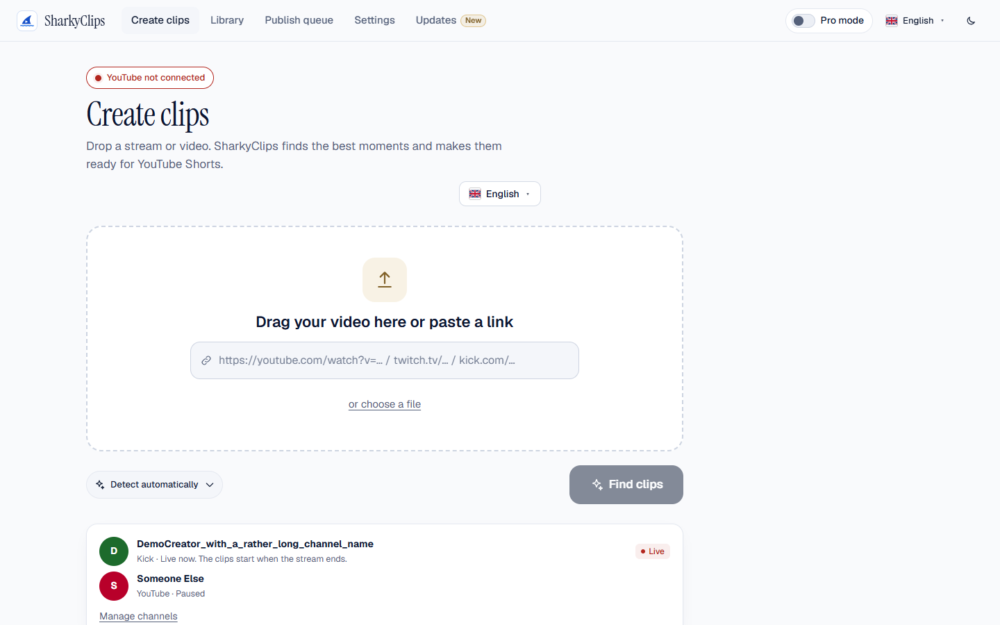 | 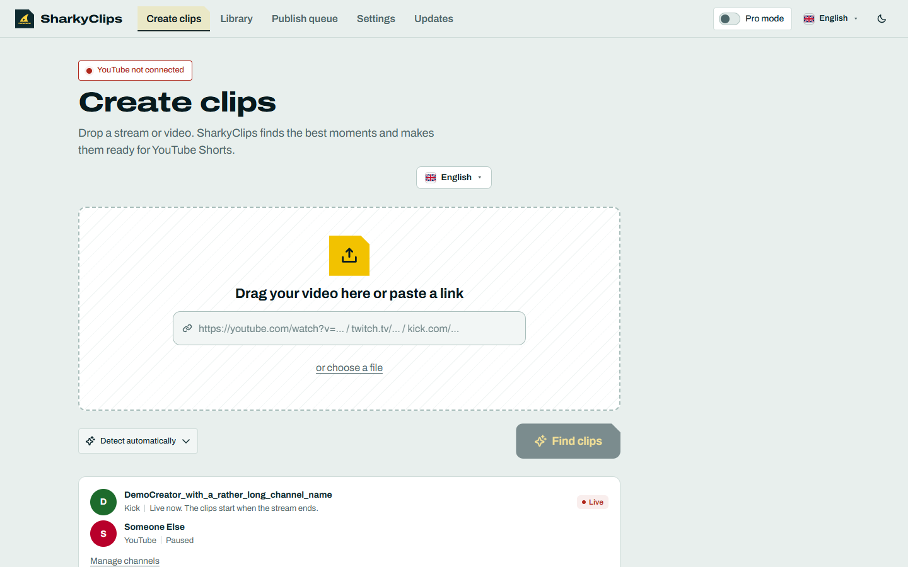 |
| Easy klipler | 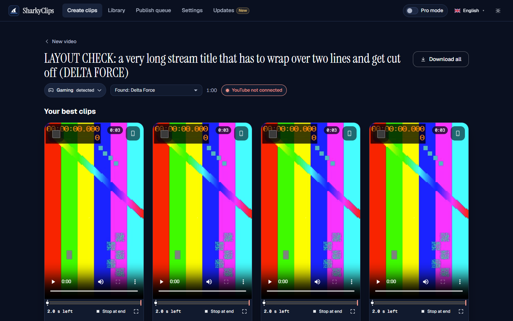 | 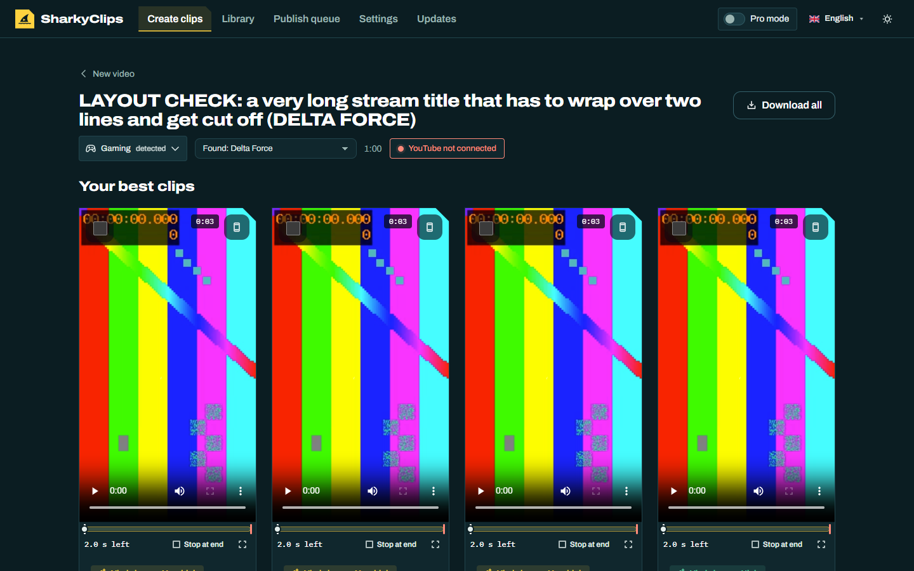 |
| Pro editör | 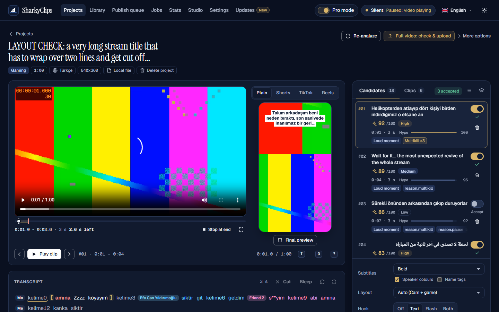 | 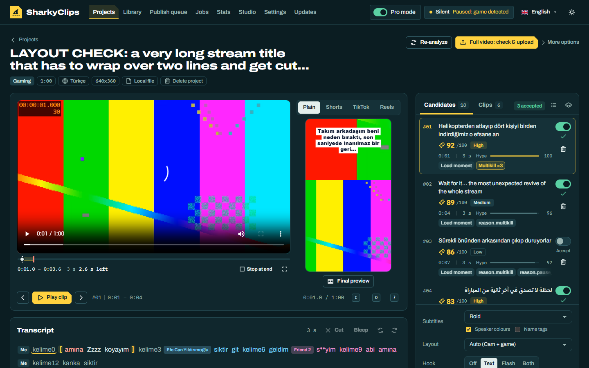 |
| Önizleme | 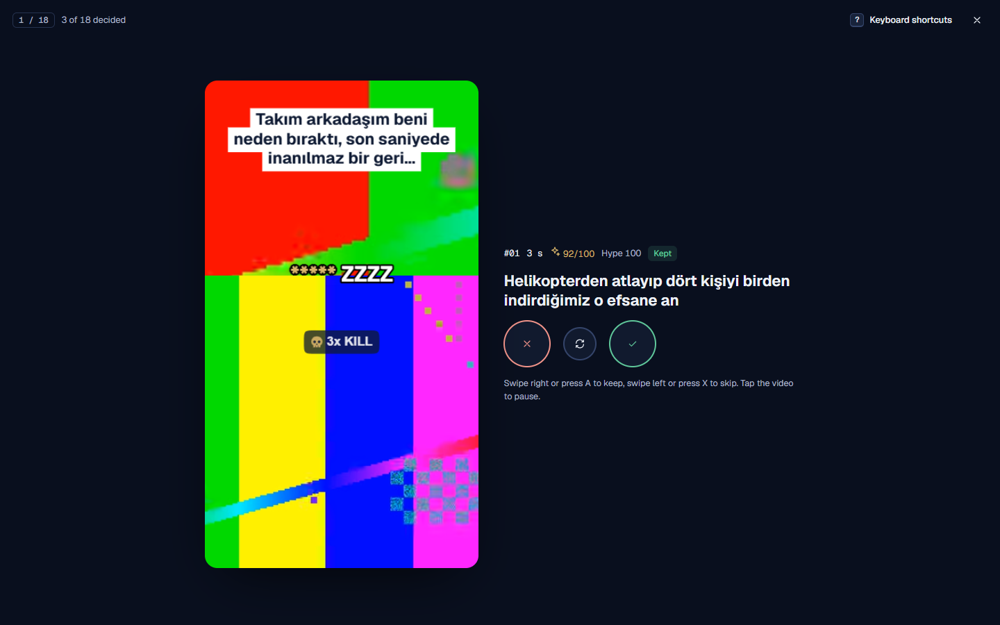 | 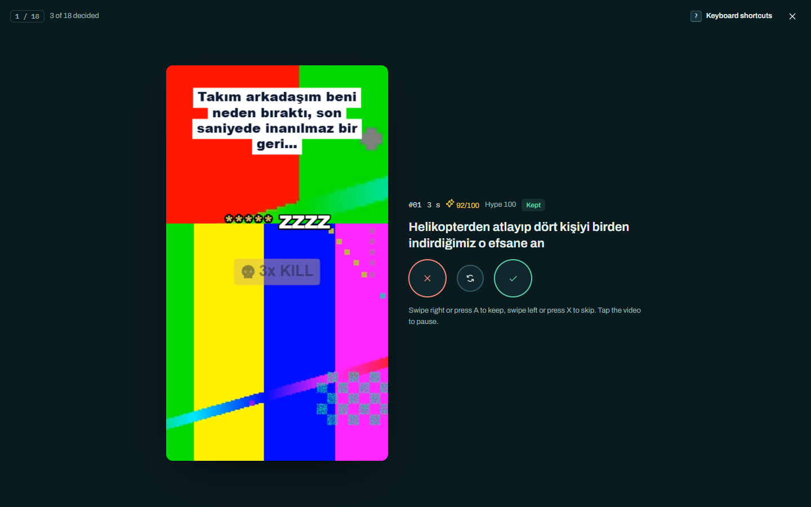 |
| Yayınla | 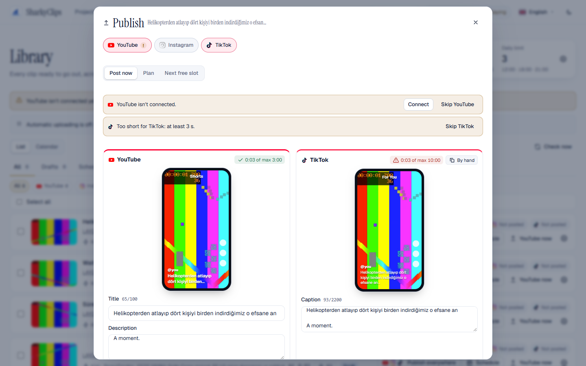 | 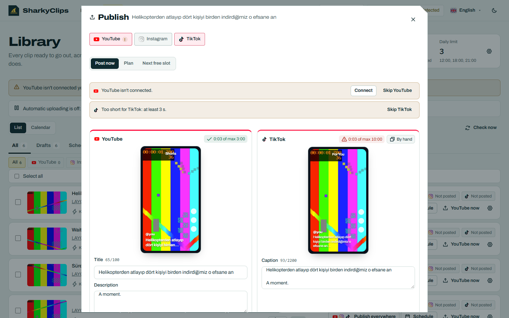 |
| Ayarlar | 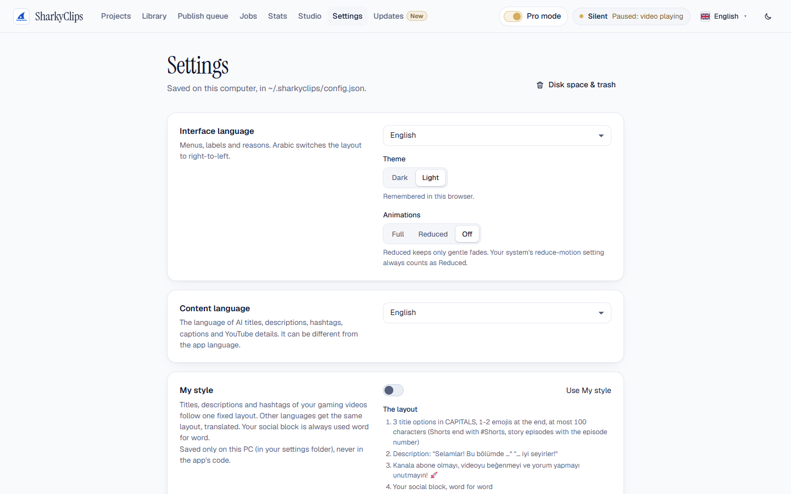 | 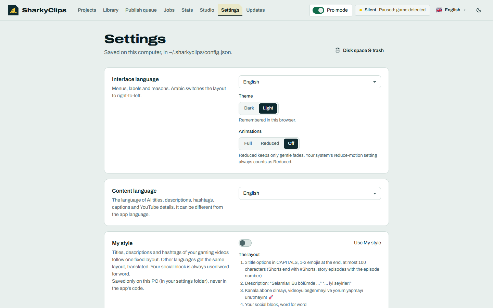 |

Yeni olanlar (önceki çekimde yoktu): açılış `redesign/after/launch-*.png`, ilk kurulum
`welcome-*.png`, mini oyun `minigame-*.png`, Güncellemeler `whatsnew-*.png`, boş kütüphane
`empty-library-*.png`. Keşif yönleri A / B / C: `redesign/A`, `B`, `C`, `compare.html`.

---

## Keşif özeti (Türkçe, 1.2.64 dalı)

Arayüz "yapay zekâ yapmış" gibi duruyordu: Geist + Instrument Serif ikilisi (2024-25 şablonlarının
en yaygın font çifti, üstelik Google'dan ağ üzerinden yükleniyor), her şey aynı yuvarlak kart +
aynı yumuşak gölge, 12 farklı köşe yarıçapı, 15'ten fazla yazı boyutu (12.5 / 13.5 gibi ara
değerler), her yerde hap (pill) şekilli rozetler, büyük harf + aralıklı bölüm başlıkları, buzlu cam
üst bar ve her listede aynı "yukarı kayarak belir" animasyonu.

Gerçek uygulamanın üzerine, özellik değiştirmeden, 3 tasarım yönü token teması olarak kuruldu
(`?design=a|b|c`, `?design=off` ile geri). Fontlar ve ikonlar uygulamanın içinde, ağ yok.
Ekran görüntüleri: `docs/redesign/A`, `B`, `C` (+ karşılaştırma için `current`), hepsi açık ve koyu.
Hepsini yan yana görmek için: `docs/redesign/compare.html`.

- **A "Savile Row"** (Harvey Specter / James Bond): lacivert, altın, gri, beyaz. Bodoni Moda
  başlıklar + Schibsted Grotesk metin, keskin 2 px köşeler, gölge yok, ince çizgiler, Phosphor Light
  ikonlar. Çok şık, ama mevcut lacivert/altın paletine en yakın olan ve oyun klibi uygulaması için
  fazla "hukuk bürosu".
- **B "Cutroom"** (profesyonel video editörü, önce koyu): grafit griler, tek turuncu "playhead"
  vurgusu, IBM Plex Sans + Plex Mono zaman kodları, yoğun 4 px ızgara, Lucide ikonlar. Pro mod ve
  editör için en doğal olanı; Easy modda biraz sert ve kategorideki herkese benziyor.
- **C "Shark Sign"** (benim önerim): derin su yeşili-mavisi + plaj köpekbalığı uyarı tabelası
  sarısı. Tek font ailesi (Archivo), başlıklarda geniş tabela kesimi, metinde normal. Tek cesur
  hamle: birincil butonlarda, kartlarda ve aktif sekmede "yüzgeç kesiği" köşe. Phosphor Bold ikonlar.

**Önerim: C.** Markaya (köpekbalığı, avlanma, "en iyi anlar") doğrudan bağlı, şablona benzemiyor,
oyun dünyasına ait ama neon-mor "gamer" klişesine düşmüyor. Pro modun editör ekranları için B'nin
iki fikrini C'ye almayı öneririm: zaman kodlarında mono font ve daha sıkı yoğunluk (Pro modda
`--gap` 12 px, 30 px butonlar). A'yı tamamen bırakmak yerine, ileride "Klasik" adıyla bir tema
seçeneği olarak tutmak mümkün.

(Bu keşif 1.2.65'te C olarak benimsendi; bkz. üstteki rapor.)

---

## 1. Tools installed (user scope, free)

- `frontend-design@anthropic-plugin-directory` 1.1.1 (Anthropic's official plugin, built-in directory).
- `ui-ux-pro-max@ui-ux-pro-max-skill` 2.15.0 (marketplace `nextlevelbuilder/ui-ux-pro-max-skill`
  added in user settings). Checked before installing: no hooks, no MCP server in the plugin root
  (only a `stack/.mcp.json` example that the plugin does not register), MIT licence. Its search
  scripts run with plain Python, no dependencies.
- `package.json` was checked first: nothing new is installed into the project. Fonts and icons were
  fetched with `npm pack --ignore-scripts` into a temp folder and only the needed files copied in.

Both plugins load in new Claude Code sessions; this session read their `SKILL.md` files directly.

How they were used:
- **ui-ux-pro-max** `--design-system` for each brief. Its output was a starting point, not the
  answer: for A it gave EB Garamond / Lato and SaaS blue (#1E3A8A), for B Inter / Inter with pink on
  slate, for C neon purple (#7C3AED) + Russo One. Its own anti-pattern list flags
  "AI purple/pink gradients", so the C and B colours were rejected. Its typography search supplied
  the Barlow / Plex / Didone candidates; its checklist (no emoji icons, 4.5:1 contrast, visible
  focus, reduced motion, 150-300 ms transitions) is followed.
- **frontend-design** for the method: ground each direction in the subject, a compact token plan,
  review the plan against the generic defaults it lists (cream + terracotta, near-black + one acid
  accent, hairline broadsheet, the SaaS card kit, ALL-CAPS eyebrows, middle-dot meta strings, mono
  labels), spend boldness in one place, then critique from screenshots.

## 2. Audit: why the current UI reads as AI-generated

Measured on `frontend/src/styles.css` + `easy.css` (5,700 lines) and screenshots in `docs/redesign/current`.

| # | Tell | Evidence |
|---|------|----------|
| 1 | The default 2024-25 template font pair | `Geist` + `Instrument Serif` (+ `Geist Mono`). Instrument Serif is a condensed display face: long stream titles turn into thin grey columns. |
| 2 | Fonts come from the network | `index.html` loads Google Fonts; the CSP opens `fonts.googleapis.com` / `fonts.gstatic.com` just for that. Offline, the UI falls back to system fonts. |
| 3 | No type scale | 15+ font sizes, many fractional: 13 px (111x), 12 px (81x), 12.5 px (54x), 13.5, 11.5, 10.5 ... |
| 4 | Radius soup | 12 different radii: 4, 6, 8, 10, 12, 14, 16, 18, 20, 22, 999 px, 50 %. |
| 5 | The SaaS card kit | `.card`, `.panel`, `.ez-card`, `.modal`, `.ez-drop` are all "1 px border + rounded + the same soft shadow". Settings is a stack of identical rounded boxes. |
| 6 | Pills everywhere | 41 rules use `999px`: status, job, governor, chips, switches, nudges, badges. |
| 7 | ALL-CAPS tracked eyebrows | `h2.section-title` is 12 px, uppercase, `letter-spacing: .06em` ("TRANSCRIPT"). |
| 8 | Frosted-glass top bar | `backdrop-filter: saturate(140%) blur(14px)`. |
| 9 | Gold means everything | the one accent marks selection, focus, badges, switches, warnings and "new": it stops meaning anything. |
| 10 | Blue-tinted slate greys | `#55617a`, `#aeb7ca`, `#25324f`: Tailwind-slate look, not a chosen palette. |
| 11 | Middle-dot meta strings | "SharkyClips 1.2.64 · What's new · All updates", "Publish · 2", "Kick · Live now". |
| 12 | Same spacing everywhere | `padding: 16px` / `gap: 16px` / `10px 12px` repeated; 180 hard-coded hex values outside the tokens. |
| 13 | Scattered motion | every list fades + slides up on enter (`page-fx`, `grid-cards > *`, `.cand`, `.clips-grid > *`, ...), plus skeleton shimmer gradients. |
| 14 | Emoji in UI strings | 👍 👎 ✅ ☰ in all 11 locales (80 occurrences); icons themselves are a decent home-made stroke set, but one weight (1.75) everywhere. |
| 15 | Generic stepper | five grey circles with checkmarks for "Finding your best moments". |

Not a problem: the navy + gold idea itself, the logo geometry, the 9:16 preview, logical
(RTL-safe) properties, the motion settings (Full / Reduced / Off).

## 3. The three directions

All three keep the token names of `styles.css` (`--gold` stays the accent token name even when it
is orange or yellow), so the themes are pure CSS + one icon switch. Contrast of the main pairs
(text, muted on bg/surface, accent text, primary button, chips, danger, success, warn) was computed
for all six palettes: every pair is at least 4.5:1 (lowest 5.02:1, B light).

### A "Savile Row" (Harvey Specter / James Bond)

- **Idea:** a bespoke suit. Confident, quiet, expensive. Gold is the cufflink, not the wallpaper.
- **Fonts:** *Bodoni Moda* (Didone, variable optical size; headlines, page titles, wordmark) +
  *Schibsted Grotesk* (Norwegian news grotesk; all UI text). Timecodes: *IBM Plex Mono*.
  OFL, bundled in `frontend/public/fonts/designs`. Cyrillic / Arabic / CJK fall back to the system.
- **Colour, dark:** bg `#0A1428` midnight navy, surface `#0F1B33`, border `#233353`, text `#E8EBF0`,
  muted `#A3ACBA` (neutral grey, not slate), gold `#C9A75E`, primary = ivory `#F4F1EA` on navy.
- **Colour, light:** bg `#F3F4F6` cool grey, surface `#FFFFFF`, text `#13213B`, muted `#5B6575`,
  gold `#A8873F` (text `#7A5F22`), primary = navy `#0A1428` with white text.
- **Shape / space:** 2-4 px corners, no shadows (borders only), 24 px panel padding, a hairline under
  every page title, active nav = 2 px gold underline, pills squared.
- **Icons:** Phosphor **Light** (MIT), thin and even, like engraved lines.
- **Motion:** 160-200 ms, `cubic-bezier(.25,.1,.25,1)`, fades only, nothing bounces.
- **Logo:** the fin without its tile, gold fin + ivory wave (dark) / navy fin + gold wave (light),
  wordmark in Bodoni 600.

### B "Cutroom" (pro video editor, dark-first)

- **Idea:** the room where the cut happens: DaVinci / Premiere / Final Cut conventions.
- **Fonts:** *IBM Plex Sans* (variable, has Cyrillic) for everything, *IBM Plex Mono* for timecodes,
  counts and scores. No display serif at all.
- **Colour, dark:** graphite bg `#141516`, panels `#1B1C1E` / `#222326`, seams `#2D2F33`,
  text `#E4E4E5`, muted `#9B9EA4`, one accent: playhead orange `#FF7A1A` (primary fill, dark text).
- **Colour, light ("daylight grade"):** bg `#E9EAEC`, panels `#F7F7F8`, text `#1B1C1E`,
  accent `#C2410C` (white text on it).
- **Shape / space:** 3-6 px corners, dense 4 px grid (12 px gap, 30 px buttons, 32 px fields set into
  the darker background), panel heads as darker header strips, selected tab/segment = orange 2 px
  underline. Diagonal hatch on the drop zone (like an empty timeline track).
- **Icons:** **Lucide** (ISC), 1.75 stroke.
- **Motion:** 90-120 ms, no easing flourishes: tools answer instantly.
- **Logo:** orange fin on a graphite tile, wordmark Plex Sans 600 at 15 px.

### C "Shark Sign" (my own direction)

- **Idea:** the yellow beach sign that says a shark was seen here. It is the most recognisable
  "shark" image there is, it is high-contrast by nature, and it is not a gaming cliché.
  The app hunts moments; the sign marks them.
- **Fonts:** one family, *Archivo* (variable width 62-125 %): headlines at 112-125 % width,
  weight 800 (signage), text at 100 % width. Using the width axis as the hierarchy is the type move.
- **Colour, dark:** deep water bg `#0B1D22`, surface `#10272D`, raised `#153138`, border `#21444C`,
  text `#E3EEEC`, muted `#9BB5B2`, sign yellow `#FFD23F` (primary fill with water-dark text).
- **Colour, light:** sea-foam bg `#E8EFED`, white surfaces, ink `#0E2A30`, primary = ink fill with
  yellow text; yellow kept for fills and marks, its text tone is `#6E5400`.
- **Shape / space:** normal 6-12 px corners, except the one bold move: a **fin-cut corner**
  (top-right chamfer, mirrored in RTL) on primary buttons, clip cards, modals, the active nav item
  and the logo tile. Section titles in expanded Archivo, no caps.
- **Icons:** Phosphor **Bold** (MIT): chunky enough to sit next to signage type.
- **Motion:** one signature only: the page body rises once with a slight overshoot
  (`cubic-bezier(.34,1.3,.64,1)`, 420 ms) when a screen opens; everything else is a plain 150 ms
  fade. Reduced / Off motion settings still win.
- **Logo:** the existing fin + wave, water-dark on a yellow tile with a fin-cut corner (dark), yellow
  on an ink tile (light); wordmark Archivo 800 at 125 % width.

## 4. How it is built (no feature changes)

- `frontend/src/designs/designs.css`: `@font-face` for the bundled fonts + the three token sets and a
  small number of component rules. Every rule is scoped to `:root[data-design=..]`, so without the
  attribute the app is byte-for-byte the same look.
- `frontend/index.html`: the pre-paint script reads `?design=a|b|c|off` (remembered in
  localStorage `sc-design`) and sets `<html data-design>`.
- `frontend/src/components/Icons.tsx`: with a design active, the same 58 icon names render from
  `frontend/src/designs/iconsets.ts` (generated from `lucide-static` 1.77.0 and
  `@phosphor-icons/core` 2.1.1; licences: ISC / MIT).
- `frontend/public/fonts/designs/*`: 18 woff2 files (~740 kB, latin + latin-ext; Plex also
  Cyrillic) + their OFL licence texts.
- `frontend/scripts/redesign-shots.mjs`: takes the 12 screenshots for one direction from the layout
  fixture server.

(1.2.64 exploration only: the `?design=` switch was removed in 1.2.65, see section 6.)

## 5. Decision log

- Worked on branch `redesign/explore`; no VERSION bump, no CHANGELOG, no push (as asked).
- Screens chosen: Home = Easy home (the default UI), Easy mode = Easy project grid, Pro editor =
  Pro project, Clip preview = Pro "Fast review" (the big 9:16 preview, opened with its button),
  Publish = the Publish dialog from the Library, Settings = Pro settings. The Easy "Preview and edit"
  button opens the same Publish dialog, and "Final preview" starts a render job, so neither was used.
- Screenshots at 1440x900, English UI, motion off. The stock layout fixture's clip options are older
  than the app, so it queued GPU renders; those were paused by the app's own governor
  ("video playing"), and I did not override it. Instead a throwaway copy of the fixture (temp folder)
  was marked as rendered with the app's own fingerprint functions, so no render ran at all.
  Follow-up worth doing separately: update `layout-fixture.py`'s `OPTIONS` to today's Easy options.
- Rejected tool suggestions: Inter (B), EB Garamond / Lato and SaaS blue (A), neon purple + Russo
  One (C), Playfair Display (editorial cliché), Barlow Condensed (sports template).
- Rejected own ideas: buoy orange for C (clashed with B's orange); acid green or vermilion accents
  (frontend-design lists both as AI tells); Plex Mono as A's text face.
- A uses proportional figures: the base CSS turns on tabular figures for all text, and in Schibsted
  that widens "." and ":" into visible gaps ("video . SharkyClips"). Timecodes keep a mono face.
- Pills were squared (A) or given 3 px corners (B); C keeps a few soft shapes on purpose, its
  identity is the fin cut, not zero radius.
- Known limits of a token-only pass, to handle if a direction is adopted: the 180 hard-coded hex
  values and fractional font sizes in `styles.css` are still there; the Google Fonts link in
  `index.html` still loads for the default look (remove it and the CSP entries when adopting); the
  emoji in locale strings remain; caption fonts in the 9:16 preview are export settings and were not
  touched (preview = export).
- Not run yet for the themes: the layout / axe / preview CI checks (they load the default look).
  Run them with `sc-design` set before adopting one.

---

## 6. Adoption (1.2.65, 2026-11-22): direction C is the only look

Asked: C plus B's mono timecodes and tighter Pro spacing, default for everyone, every screen,
all 15 tells fixed, fonts local, old theme and `?design` removed, site + installer art, checks in
all 11 languages. Unattended: every decision is logged here.

### What changed, per audit tell

| # | Tell | Fix in 1.2.65 |
|---|------|---------------|
| 1 | Template font pair | Archivo only (width axis: 125 % headlines, 100 % text) + IBM Plex Mono for timecodes, counts, sizes (B's idea). |
| 2 | Fonts from the network | `frontend/public/fonts` (OFL), `src/fonts.css`; Google Fonts link + CSP entries removed; the launcher's splash file gets Archivo inlined as a data: URI (`welcome._font_data_uri`: a file:// page can't load a font file). |
| 3 | No type scale | 10 tokens `--fs-2xs` .. `--fs-5xl` (11-44 px); every `font-size` in the CSS uses them, except the drawn phone mock-ups (`.mp-ui`, `.pview`, 9.5-10 px, scaled art) and `cqh` sizes. |
| 4 | Radius soup | 4 radii `--r-xs/sm/md/lg` (4/6/8/12) + 50 % circles + the fin cut (`--cut` 14 px, `--cut-card` 22 px). |
| 5 | SaaS card kit | Shadows gone (`--shadow: none`); cards are borders only; clip cards and dialogs get the fin cut; panel padding is a token (`--pad`). |
| 6 | Pills | All 999 px pills -> 4 px; only switches and Google's sign-in button (their brand rule) stay round. |
| 7 | ALL-CAPS eyebrows | Section titles are expanded Archivo 800, no caps; Updates groups, markdown h4, beta chip, hardware labels too. The swipe stamps keep caps on purpose (they are signs). |
| 8 | Frosted top bar | Solid background, no blur; also no blur behind dialogs. |
| 9 | Gold means everything | Yellow = main action + "hit" marks (scores, New). New tokens: `--select` (ink, selected segment / tab / card), `--on` (green, switches), warnings stay `--warn`. |
| 10 | Slate greys | Deep-water teal greys from C. |
| 11 | Middle-dot strings | 150 in the TSX: JSX -> `<Sep />` (thin rule, screen readers hear a comma), JS strings -> ", "; 26 per locale -> the language's comma (، ，、), "A/B: x" for two keys. |
| 12 | Same spacing / hard-coded hex | 238 -> 70 hex values; the rest are deliberate: platform brand colours, Google's button rules, the Google consent-screen illustrations, phone mock-ups, the speaker caption colours (export look). New tokens `--media-bg`, `--on-media`, `--tip-bg`, `--danger-fill`, `--on-sign`. Pro mode gets B's density through `:root[data-ui="pro"]` (`--gap` 12, `--pad` 16). |
| 13 | Scattered motion | The stagger-in on every list and the bar grow animations are gone; one signature: the page rises once with a slight overshoot (`--ease-sign`). Dialogs and toasts fade. |
| 14 | Emoji in strings | 👍 👎 ✅ ☰ removed from all 11 locales (words instead; the bleep badge shows a check icon). Icons: Phosphor Bold for all 58 names (`Icons.tsx`, licence in `public/fonts/LICENSE-phosphor.txt`). |
| 15 | Generic stepper | "Depth gauge": numbered mono marks on a dotted rail, done = green solid rail, the running step is the yellow fin-cut sign with a progress bar under its text. |

### Decisions

- **One stylesheet, no theme layer.** C's tokens replaced the old ones in `styles.css`, and C's
  component rules were written into the base rules (not appended), so no overridden dead rules
  remain. `designs/designs.css`, `designs/iconsets.ts`, the A/B fonts and `redesign-shots.mjs`
  were moved out of the repo into the session scratchpad (moved, not deleted: they were untracked
  exploration files; the user asked for the switch to go). `index.html` clears the old
  `sc-design` key once.
- **Fonts are not hashed** (`public/fonts`, absolute `/fonts/..`): the splash writer reads the same
  file from `frontend/dist/fonts`. Archivo has no Cyrillic, Arabic or CJK: those fall back to the
  system font (Segoe UI / Microsoft YaHei); Plex Mono has Cyrillic.
- **Mono never fakes bold**: only 400/500 are bundled, `.mono` sets `font-synthesis-weight: none`.
- **Unused CSS** (scan of every class against the TSX): 9 dead classes removed, also the old
  `.splash` block (replaced by `.launch` in 1.2.2).
- **Welcome (first run)** keeps its own light look in both themes, now in the light C palette
  with the fin-cut primary button. The **launch animation**: yellow fin + teal water (dark),
  ink fin (light), Archivo 800 wordmark.
- **Mini game**: water colours moved from blue to deep-water teal, HUD text in Archivo.
- **Not touched on purpose**: caption fonts and colours in the 9:16 preview (preview = export;
  only the never-loaded "Geist" was dropped from the preview's font stack, so the preview now uses
  the same Arial fallback as the render), the best-of montage title cards (an export look, also
  `docs/how-it-works.md`), platform colours.
- **Logo / installer**: `make_icons.py` draws the yellow sign tile with the fin cut (dark) and
  the ink tile (light); new Inno Setup wizard images (`installer/windows/wizard*.bmp`, 100/150/200 %).
  `docs/logo-120.png` (Google OAuth consent screen) is **not** redrawn: changing it there starts
  a new Google brand review. `python installer/make_icons.py --google` redraws it when wanted.
- **Public site** (`docs/site`): same tokens, local fonts (`docs/site/fonts`), new mark and
  favicon, fin-cut Download button; the policy text is unchanged (Google reviewed it).
- **Test project** (`layout-fixture.py`): the clips are now stamped with the options, cut and
  fingerprints the app wants today, asked from the app itself (`_stamp_current`), so no check
  ever queues a render again.
- New scripts: `frontend/scripts/screens.mjs` (15 pages) and `screens-extra.mjs` (launch,
  welcome, mini game, What's new, empty state) for before / after shots.
